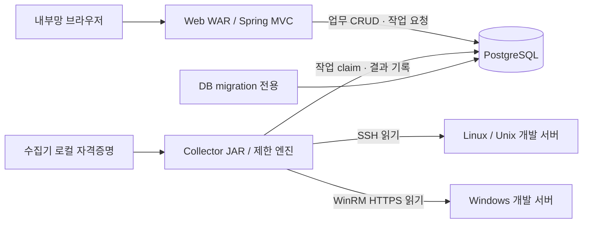

# Project202701 최종 통합 화면설계서 · AI 바이브 코딩 작업지시서 v1.1

**작성일** 2026-11-26 | **상태** 프로토타입 개발 명세 / 운영 승인 전 | **기준** 기획안 v0.3 및 AGENTS.md (첨부 원문)

## 0. 사용법 및 설계 책임

- 이 문서는 UI-00~21의 구현 계약과 DEV-00~09 작업 지시, 요구사항/테스트 추적을 하나로 연결한다. 함께 제공되는 PPT 및 Figma는 검토용 시각 설계, MagicPath는 가상 데이터 기반 화면 시연이며 서버 구현이 아니다. 각 화면 ID와 라우트는 원문과 동일하다.
- 우선순위: 사용자 확정 및 기획안 v0.3 불변 원칙 > 원본 AGENTS.md > 본 문서의 구체화 > 화면 예시. 충돌 시 코드 변경 전 docs/decisions.md에 기록한다. 새로 구체화한 URL·권한·동작·필드명은 개발 설계 선택이며 운영 승인으로 간주하지 않는다.
- 실제 수집은 승인된 개발 서버에 한정. 모의/실제 데이터 완전 분리. 3개 OS군 실제 수집 증거가 있어야 프로토타입 완료. 성능 SLA, SSO/MFA 상세, 위험수용, 운영 일정 등은 유보. DB 우선, 비밀은 수집기 로컬만, 웹·수집기 직접 통신 없음, 임의 명령 없음, 관리자 최종 판단.
- 외부 도구로 전송하는 화면은 가상 데이터만. 공식 CI 로고·하나서체 승인 미확인, v0.3 참고 색상으로 대체. 라이브러리 정확한 패치 버전은 DEV-00 smoke test에서 고정한다.

## 1. 디자인 시스템 및 공통 UI 계약

| 토큰 | 값 | 사용처 |
|---|---|---|
| brand | #009178 | 브랜드 포인트(참고값) |
| primary | #007A68 | 주요 버튼·선택 링크 |
| selected | #E6F5F1 | 활성 메뉴/선택 행 |
| canvas | #F5F7F9 | 업무 배경 |
| surface | #FFFFFF | 카드·표·입력 |
| ink | #172B29 | 본문 |
| muted | #526765 | 보조 텍스트 |
| border | #DCE5E4 | 표/입력 경계 |
| warning | #A65D00 | 불일치·검토 필요 |
| danger | #C62828 | 실패·거부 |
| info | #175CD3 | 정보·수동 등록 |

- 1440×900 기준, 최소 1280px 시험. 좌측 224px/상단 56px/본문 padding 24px/8px 단위. 표 행 44px, 본문 14px, 제목 24px, 소제목 16px. 밀집 표는 가로 스크롤, 헤더 고정, 첫 식별 열 고정 옵션. 1280에서 콘텐츠 침범 금지. 승인된 하나서체 우선, Noto Sans KR 대체. 로고는 공식 원본 입수 후 교체.
- 헤더: 시스템명(임시 Project202701), 개발환경 및 MOCK/REAL 명시, 로그인 사용자, 로그아웃. 메뉴: 대시보드 / 자산 / 인벤토리(OS·SW) / 정합성 / 통합검색 / 이슈 / 수집(작업·일정) / 탐지규칙 / 제품 / 이력 / 보고서 / 관리(감사·설정). 상세 화면은 breadcrumb 및 목록 복귀. 엑셀 UI-21은 공통 진입.
- 컴포넌트: JSP layout/tag 또는 include, table, filter bar, pagination, badge, form control, drawer/dialog, confirm, alert, error summary, toast, empty, skeleton, progress. 공통 JS ES modules: fetch wrapper, filter/url state, table selection, dialog focus trap 및 form validation. JS 라이브러리/CDN 불필요. 페이지별 ES module만 로드. 클라이언트 필터는 데모에만 사용; 구현은 서버 필터.
- 키보드 탐색, 명시적 label, focus ring, 모달 ESC 및 focus 복귀, aria-live 상태 메시지, 4.5:1 일반 텍스트 대비 목표. 색상만으로 상태 전달 금지. 경고는 이유 및 다음 행동을 명시. 버튼 비활성에는 사유 텍스트. 필수 입력은 *와 문구 병기.
- 목록: 50행 기본(20/50/100), 정렬 allowlist + id tie-break, 검색 버튼/Enter, 초기화, 적용 조건 칩, 서버 결과 총수 및 기준 시각. URL query에 필터/페이지/정렬/탭 유지, 상세 복귀 시 복원. 필터 변경 시 page=1, 선택 초기화. 선택은 현재 페이지 기준, 전체 선택 범위 명시. export는 현재 전체 필터 결과; 선택 내보내기는 별도 구분. 동일 조건·snapshot 기준 표시.
- 표준 상태: loading(버튼 중복 금지), initial empty(등록/양식 안내), filter empty(초기화), error(재시도/traceId), forbidden(403), unsupported(지원 범위), stale(마지막 정상 시각), partial(스코프/실패 원인), disabled(이유). 401은 로그인, 409는 최신 비교/재확인, 429 재요청 제한. 0/미수집/미확인 구분.
- 프로토타입 권한 설계(위임 선택): VIEWER 조회/허용 export, OPERATOR 자산/보정/판단/수집 요청, ADMIN 규칙 활성·일정·기본 계정 설정, AUDITOR 감사 조회. 서버에서 객체 범위/액션을 검증. UI 버튼 숨김은 보안 수단 아님. 운영 RBAC/SSO/MFA 상세는 유보.

## 2. 전체 화면·개발·검증 추적표

| 화면 ID | 화면 | 라우트 | DEV | 요구사항 | 시험 |
|---|---|---|---|---|---|
| UI-00 | 로그인 | `/login` | DEV-02 | FR-029 | T-33 |
| UI-01 | 대시보드 | `/dashboard` | DEV-02, DEV-08 | FR-004, FR-009, FR-010, FR-011, FR-029, FR-033 | T-27, T-29 |
| UI-02 | 자산 목록 | `/assets` | DEV-02 | FR-001, FR-002, FR-003, FR-004, FR-010, FR-029, FR-030 | T-07, T-27, T-31, T-34 |
| UI-03 | 자산 등록·상세 | `/assets/new · /assets/{id}` | DEV-02, DEV-04 | FR-001, FR-003, FR-004, FR-007, FR-010, FR-017, FR-036 | T-07, T-08, T-30, T-34 |
| UI-04 | OS 인벤토리 | `/inventory/os` | DEV-06 | FR-005, FR-006, FR-008, FR-010, FR-032, FR-033, FR-035, FR-036 | T-19, T-23, T-25, T-30 |
| UI-05 | SW 인벤토리 | `/inventory/software` | DEV-06 | FR-006, FR-007, FR-008, FR-013, FR-014, FR-016, FR-018, FR-019, FR-032, FR-033 | T-01, T-04, T-05, T-19, T-26 |
| UI-06 | 설치 상세 | `/inventory/installations/{id}` | DEV-06 | FR-007, FR-008, FR-010, FR-017, FR-018, FR-019, FR-032, FR-034 | T-01, T-06, T-19, T-20, T-21, T-22, T-23, T-24 |
| UI-07 | 데이터 정합성 | `/reconciliation` | DEV-06 | FR-006, FR-010, FR-032, FR-033, FR-034, FR-035 | T-19, T-20, T-21, T-22, T-23, T-24, T-25, T-26, T-27, T-34 |
| UI-08 | 통합 검색 | `/search` | DEV-07 | FR-006, FR-014, FR-015, FR-017, FR-030, FR-033 | T-02, T-03, T-06, T-26, T-27 |
| UI-09 | 보안 이슈 목록·등록 | `/issues` | DEV-07 | FR-026, FR-027, FR-028, FR-030 | T-03, T-16, T-26 |
| UI-10 | 영향 조사 | `/issues/{id}` | DEV-07 | FR-015, FR-026, FR-027, FR-028, FR-034 | T-03, T-16, T-26, T-34 |
| UI-11 | 수집 작업 | `/collection/jobs` | DEV-03, DEV-08 | FR-003, FR-004, FR-010, FR-011, FR-029, FR-036 | T-07, T-10, T-11, T-12, T-29, T-34 |
| UI-12 | 작업 상세 | `/collection/jobs/{id}` | DEV-03 | FR-008, FR-010, FR-011, FR-018, FR-036 | T-04, T-07, T-10, T-11, T-12, T-14, T-18 |
| UI-13 | 수집 일정 | `/collection/schedules` | DEV-08 | FR-004, FR-029 | T-11, T-34 |
| UI-14 | 탐지 규칙 목록 | `/rules` | DEV-08 | FR-022, FR-023, FR-024, FR-025, FR-029 | T-09, T-13, T-34 |
| UI-15 | 규칙 작성·시험 | `/rules/{id}` | DEV-08 | FR-022, FR-023, FR-024, FR-025 | T-09, T-10, T-13, T-34 |
| UI-16 | 제품 사전 | `/products` | DEV-02 | FR-006, FR-014, FR-015, FR-019, FR-029 | T-01, T-02, T-03, T-34 |
| UI-17 | 변경 이력 | `/history` | DEV-08 | FR-009, FR-010, FR-018, FR-025, FR-028, FR-032, FR-034 | T-05, T-19, T-21, T-22, T-27 |
| UI-18 | 보고서 | `/reports` | DEV-08 | FR-006, FR-029, FR-030, FR-033 | T-14, T-27, T-29, T-31 |
| UI-19 | 감사 로그 | `/admin/audit` | DEV-01, DEV-08 | FR-029, FR-030, FR-032, FR-034 | T-14, T-28, T-33, T-34 |
| UI-20 | 시스템 설정 | `/admin/settings` | DEV-01, DEV-08 | FR-004, FR-029, FR-036 | T-09, T-28, T-29, T-33 |
| UI-21 | 엑셀 처리 공통 | `/imports/{id}` | DEV-02, DEV-06, DEV-08 | FR-002, FR-022, FR-030, FR-035 | T-25, T-31, T-34 |

## 3. 화면 상세설계 (22개)

다음 화면 예시는 전부 가상 값이다. 필드 ID는 화면 ID + F01… 순서, 액션 ID는 화면 ID + A01… 순서로 생성한다. API에 v0.3 미정의 세부 조회/수정 경로가 필요한 곳은 추가 설계로 표기했다. 실제 API OpenAPI는 구현 전 계약 테스트로 고정한다.

### UI-00 로그인

**경로** `/login` | **권한** 인증되지 않은 사용자 | **개발** DEV-02

**영역** 상단 제목/설명, 검색·입력, 작업 버튼, 입력 폼 및 관련 정보, 공통 상태/피드백. 계정 또는 비밀번호 확인. 개별 계정 인증 및 실패 감사.

| 필드 ID | 입력·필터·표시 | 검증/기본값 |
|---|---|---|
| UI-00-F01 | 계정 ID* | 필수 문자열, 계정 ID trim; 서버 인증 전 존재 여부 노출 금지. |
| UI-00-F02 | 비밀번호* | password input, 전송 TLS, 저장 해시; 표시/로그 금지 |

| 액션 ID | 동작 | 결과 / 확인 |
|---|---|---|
| UI-00-A01 | 로그인 | 인증 폼 POST /login, 서버에서 자격·활성 검증 후 세션 재발급 및 UI-01 이동. 실패는 동일 문구, 비밀번호 초기화, 감사. |
| UI-00-A02 | 입력 초기화 | 계정과 비밀번호 입력값만 제거하고 계정 필드 포커스; 서버 요청 없음. |

**API** `Spring Security POST /login; POST /logout`  
**DB** `users, roles, user_roles, audit_logs`  
**핵심 처리 및 예외** 일반화된 오류; 기본 비밀번호 금지; 로그인 성공 후 UI-01. 비밀번호는 화면/로그에 노출하지 않는다.  
**검증** T-33; 조회·수정 권한, 필수값·오류·빈 결과·중복 요청과 목록 복귀 테스트 포함.

**화면 예시**

| 계정 ID | 비밀번호 |
| --- | --- |
| dev-user | •••••••• |

### UI-01 대시보드

**경로** `/dashboard` | **권한** 조회 이상 | **개발** DEV-02, DEV-08

**영역** 상단 제목/설명, 검색·입력, 작업 버튼, 요약 지표 및 목록, 공통 상태/피드백. 등록/활성 자산. 최근 성공·부분 성공. 수집 실패. 미검토 불일치.

| 필드 ID | 입력·필터·표시 | 검증/기본값 |
|---|---|---|
| UI-01-F01 | 환경 | 선택/전체 기본; 허용 코드·형식 검증; 빈 필터는 제한 없음 |
| UI-01-F02 | OS군 | 선택/전체 기본; 허용 코드·형식 검증; 빈 필터는 제한 없음 |
| UI-01-F03 | 기준 기간 | 선택/전체 기본; 허용 코드·형식 검증; 빈 필터는 제한 없음 |
| UI-01-F04 | 모드(읽기 전용) | 읽기 전용, 서버 응답 |

| 액션 ID | 동작 | 결과 / 확인 |
|---|---|---|
| UI-01-A01 | 자산 보기 | 카드의 모드·환경·기간을 URL에 전달해 UI-02 이동; 활성 자산 단위 유지. |
| UI-01-A02 | 불일치 검토 | UI-07 설치 탭, MISMATCH + PENDING 및 해당 환경/기간으로 이동; 카드 분모와 동일. |
| UI-01-A03 | 실패 조회 | UI-11에 실패/시간초과 결과 및 카드 기간 전달; 마지막 성공값 삭제 금지. |
| UI-01-A04 | 새로고침 | 동일 필터의 서버 집계 재요청; 로딩 후 기준 시각 갱신, 실패 시 이전 값과 오류 안내. |

**API** `GET /api/v1/dashboard (추가 설계)`  
**DB** `assets, scan_runs, reconciliation, assessments`  
**핵심 처리 및 예외** 카드 클릭은 동일 모드·기간·단위의 필터로 이동. OS/설치 단위 혼합 금지. 신선도/실패/미검토는 독립 지표.  
**검증** T-27, T-29; 조회·수정 권한, 필수값·오류·빈 결과·중복 요청과 목록 복귀 테스트 포함.

**화면 예시**

| OS군 | 활성 자산 | 최근 성공 | 확인 필요 |
| --- | --- | --- | --- |
| Linux | 2 | 2 | 0 |
| Unix | 1 | 1 (부분 성공) | 1 |
| Windows | 2 | 0 | 2 |

### UI-02 자산 목록

**경로** `/assets` | **권한** 조회/작업자 | **개발** DEV-02

**영역** 상단 제목/설명, 검색·입력, 작업 버튼, 결과 표 및 상세 영역, 공통 상태/피드백. 자산명 클릭 → UI-03. 선택 수집 → UI-11. 업로드 → UI-21.

| 필드 ID | 입력·필터·표시 | 검증/기본값 |
|---|---|---|
| UI-02-F01 | 자산명/IP | 선택/전체 기본; 허용 코드·형식 검증; 빈 필터는 제한 없음 |
| UI-02-F02 | OS군 | 선택/전체 기본; 허용 코드·형식 검증; 빈 필터는 제한 없음 |
| UI-02-F03 | 환경 | 선택/전체 기본; 허용 코드·형식 검증; 빈 필터는 제한 없음 |
| UI-02-F04 | 담당자 | 선택/전체 기본; 허용 코드·형식 검증; 빈 필터는 제한 없음 |
| UI-02-F05 | 중요도 | 선택/전체 기본; 허용 코드·형식 검증; 빈 필터는 제한 없음 |
| UI-02-F06 | 활성 | 선택/전체 기본; 허용 코드·형식 검증; 빈 필터는 제한 없음 |
| UI-02-F07 | 수집상태 | 선택/전체 기본; 허용 코드·형식 검증; 빈 필터는 제한 없음 |
| UI-02-F08 | 마지막 성공 기간 | 선택/전체 기본; 허용 코드·형식 검증; 빈 필터는 제한 없음 |

| 액션 ID | 동작 | 결과 / 확인 |
|---|---|---|
| UI-02-A01 | 자산 등록 | UI-03 신규 폼 열기; 저장 전 DB 자산 생성 금지. |
| UI-02-A02 | 엑셀 양식 | 자산 XLS-01의 현재 schemaVersion 양식 다운로드; 예시 행과 코드표 제공. |
| UI-02-A03 | 업로드 | UI-21 자산 양식으로 진입; 검증/확정 전 업무값 불변. |
| UI-02-A04 | 내보내기 | 필터·권한·모드·기준 시각 동일한 XLSX; 선택 건과 전체 필터 결과 구분. |
| UI-02-A05 | 선택 수집 | 현재 페이지 선택 자산 ID에 대해 허용 여부 검증, POST jobs; 개별 접수/거부 결과와 작업 ID 표시. |
| UI-02-A06 | 비활성화 | 선택 자산과 진행 작업 확인, 사유/expectedRevision 제출; 비활성 후 신규 작업 거부, 진행 작업 취소 요청 및 종료 확인; 이력 보존. |

**API** `GET/POST /api/v1/assets; PATCH /api/v1/assets/{id}; POST /api/v1/jobs`  
**DB** `assets, asset_endpoints, scan_jobs, latest_os`  
**핵심 처리 및 예외** 중복은 구역·환경·주소·포트 기준, IP 단독 병합 금지. 비활성화는 이력 보존, 새 작업 거부; 실행 중 취소 요청 및 종료 확인.  
**검증** T-07, T-27, T-31, T-34; 조회·수정 권한, 필수값·오류·빈 결과·중복 요청과 목록 복귀 테스트 포함.

**화면 예시**

| 자산명 | 주소 | OS군 | 환경 | 담당자 | 마지막 성공 | 수집 상태 |
| --- | --- | --- | --- | --- | --- | --- |
| DEV-LNX-01 | 192.0.2.11 | Linux | 개발 | 담당 A | 11-26 09:20 | 성공 |
| DEV-LNX-02 | 192.0.2.12 | Linux | 개발 | 담당 B | 11-26 09:20 | 성공 |
| DEV-UNX-01 | 192.0.2.21 | Unix | 개발 | 담당 A | 11-26 09:18 | 부분 성공 |
| DEV-WIN-01 | 192.0.2.31 | Windows | 개발 | 담당 C | 미수집 | 미수집 |
| DEV-WIN-02 | 192.0.2.32 | Windows | 개발 | 담당 C | 11-25 08:30 | 실패 |

### UI-03 자산 등록·상세

**경로** `/assets/new · /assets/{id}` | **권한** 작업자 | **개발** DEV-02, DEV-04

**영역** 상단 제목/설명, 검색·입력, 작업 버튼, 입력 폼 및 관련 정보, 공통 상태/피드백. 기본 정보. OS. 설치 인스턴스. 수집·변경 이력.

| 필드 ID | 입력·필터·표시 | 검증/기본값 |
|---|---|---|
| UI-03-F01 | 자산명* | 필수; 서버 검증; 공백 제거 및 길이/코드 검증 |
| UI-03-F02 | IP/FQDN* | 정규화·주소 형식 검증; 실제 접속 허용목록 별도 |
| UI-03-F03 | OS군* | LINUX/UNIX/WINDOWS enum. 변경 시 endpoint/지원 프로필 재검증. |
| UI-03-F04 | 환경* | 개발환경 코드 선택; REAL/MOCK 별도이며 임의 운영 선택 금지. |
| UI-03-F05 | 수집 방식* | SSH/WinRM 중 OS군과 호환되는 방식만. |
| UI-03-F06 | 활성 여부* | boolean; 신규 활성 여부와 실제 연결 허가는 별도. |
| UI-03-F07 | 포트 | 정수 1~65535; 기본 SSH 22 / WinRM HTTPS 5986, 실제 허용 정책 별도. |
| UI-03-F08 | 구역 | 선택/전체 기본; 허용 코드·형식 검증; 빈 필터는 제한 없음 |
| UI-03-F09 | 담당자 | 선택/전체 기본; 허용 코드·형식 검증; 빈 필터는 제한 없음 |
| UI-03-F10 | 프로필 참조 | collector 로컬에서 허용한 비밀 없는 프로필 참조 ID; 비밀 내용 입력 불가. |
| UI-03-F11 | 호스트 공개 지문 | 검증된 공개 지문/인증서 식별 정보; 미확인/변경은 실제 연결 차단. |
| UI-03-F12 | 검증일 | timestamptz 서버 기록, 검증 주체와 연결. |
| UI-03-F13 | 허가 기록 | 허가 기록 참조 필수(REAL 시험); 미허가 시 CONFIG_REQUIRED. |
| UI-03-F14 | 노출 주장/출처/일자 | 노출 상태 enum + 출처·확인일·근거; 확인되지 않으면 UNKNOWN. 리스닝과 독립. |

| 액션 ID | 동작 | 결과 / 확인 |
|---|---|---|
| UI-03-A01 | 저장 | 필수 필드/중복 endpoint/권한/expectedRevision 검사; POST 신규 또는 PATCH 기존 자산; 성공 상세 표시, 409 최신값 재조회. |
| UI-03-A02 | 취소 | 편집 내용이 변경됐으면 이탈 확인 후 UI-02의 기존 검색 상태 복원; 저장하지 않음. |
| UI-03-A03 | 연결 시험 | 저장된 승인 endpoint 기준 연결 시험 job 접수; 미허가·미검증·REAL OFF 시 CONFIG_REQUIRED; 비밀 입력 금지. |
| UI-03-A04 | 즉시 수집 | 저장된 활성·허가 자산 ID로 BASIC job 접수; 202와 job ID 표시; 수집 성공으로 표기하지 않음. |
| UI-03-A05 | 비활성화 | 사유/expectedRevision 확인 후 soft deactivate, 새 작업 거부·진행 작업 취소 요청; 기록 보존. |

**API** `GET/PATCH /api/v1/assets/{id}; POST /api/v1/assets; POST /api/v1/jobs`  
**DB** `assets, asset_endpoints, exposure_evidence`  
**핵심 처리 및 예외** 실제 연결 시 검증된 지문/인증서·허가·프로필 필수. 개인키/비밀번호 필드 금지. OS군·프로토콜 변경 시 endpoint 재검증 및 기존 작업 정리.  
**검증** T-07, T-08, T-30, T-34; 조회·수정 권한, 필수값·오류·빈 결과·중복 요청과 목록 복귀 테스트 포함.

**화면 예시**

| 자산명 | IP/FQDN | OS군 | 환경 | 프로필 | 공개 지문 |
| --- | --- | --- | --- | --- | --- |
| DEV-LNX-02 | 192.0.2.12 | Linux | 개발 | DEV_SSH | 검증 필요 |

### UI-04 OS 인벤토리

**경로** `/inventory/os` | **권한** 조회/작업자 | **개발** DEV-06

**영역** 상단 제목/설명, 검색·입력, 작업 버튼, 결과 표 및 상세 영역, 공통 상태/피드백. 자동 OS/커널/아키텍처와 관리값. 필드별 근거.

| 필드 ID | 입력·필터·표시 | 검증/기본값 |
|---|---|---|
| UI-04-F01 | 자산 | 선택/전체 기본; 허용 코드·형식 검증; 빈 필터는 제한 없음 |
| UI-04-F02 | OS군 | 선택/전체 기본; 허용 코드·형식 검증; 빈 필터는 제한 없음 |
| UI-04-F03 | OS 버전 | 선택/전체 기본; 허용 코드·형식 검증; 빈 필터는 제한 없음 |
| UI-04-F04 | 비교 상태 | 선택/전체 기본; 허용 코드·형식 검증; 빈 필터는 제한 없음 |
| UI-04-F05 | 수정 여부 | 선택/전체 기본; 허용 코드·형식 검증; 빈 필터는 제한 없음 |
| UI-04-F06 | 신선도 | 선택/전체 기본; 허용 코드·형식 검증; 빈 필터는 제한 없음 |
| UI-04-F07 | 수집 상태 | 선택/전체 기본; 허용 코드·형식 검증; 빈 필터는 제한 없음 |

| 액션 ID | 동작 | 결과 / 확인 |
|---|---|---|
| UI-04-A01 | 보정 | 선택 자산의 OS 관측/보정/유효값 비교 drawer 열기; fieldCode·새 값·사유·baseObservationId·expectedRevision 입력 후 POST overrides. OS 원본 불변. |
| UI-04-A02 | 상세 비교 | 선택 OS 필드의 A/M/E, 근거, 신선도, 검토 이력 조회; OS 전용 drawer, SW 설치 상세로 잘못 이동 금지. |
| UI-04-A03 | 엑셀 업로드 | OS 보정 XLS-02를 선택해 UI-21 진입; 대상 ID/revision/관측 기준 재검증. |
| UI-04-A04 | 내보내기 | OS 전용 필터와 모드 기준 XLSX, 관측/관리값 및 비교 상태 포함. |

**API** `GET /api/v1/inventory/os; POST /api/v1/overrides`  
**DB** `os_observations, latest_os, os_overrides, reconciliation`  
**핵심 처리 및 예외** OS 필드 단위 수정; 자동 원본 수정 금지. 기준 관측 없는 값은 확인 불가/수동 등록 분리.  
**검증** T-19, T-23, T-25, T-30; 조회·수정 권한, 필수값·오류·빈 결과·중복 요청과 목록 복귀 테스트 포함.

**화면 예시**

| 자산 | OS군 | 자동 OS | 관리 OS | 커널/빌드 | 비교 상태 |
| --- | --- | --- | --- | --- | --- |
| DEV-LNX-01 | Linux | Rocky 9.4 | Rocky 9.4 | 5.14.0 | 자동 수집 |
| DEV-UNX-01 | Unix | AIX 7.3 | AIX 7.3 | 7.3 | 일치 |
| DEV-WIN-02 | Windows | Server 2022 | Server 2022 | 20348 | 확인 불가 |

### UI-05 SW 인벤토리

**경로** `/inventory/software` | **권한** 조회/작업자 | **개발** DEV-06

**영역** 상단 제목/설명, 검색·입력, 작업 버튼, 결과 표 및 상세 영역, 공통 상태/피드백. 설치별 locator. 자동/수동/관리 버전. 증거·관측 시각.

| 필드 ID | 입력·필터·표시 | 검증/기본값 |
|---|---|---|
| UI-05-F01 | 자산 | 선택/전체 기본; 허용 코드·형식 검증; 빈 필터는 제한 없음 |
| UI-05-F02 | 제품 | 선택/전체 기본; 허용 코드·형식 검증; 빈 필터는 제한 없음 |
| UI-05-F03 | 버전 출처 | 선택/전체 기본; 허용 코드·형식 검증; 빈 필터는 제한 없음 |
| UI-05-F04 | 버전 범위 | 선택/전체 기본; 허용 코드·형식 검증; 빈 필터는 제한 없음 |
| UI-05-F05 | OS군 | 선택/전체 기본; 허용 코드·형식 검증; 빈 필터는 제한 없음 |
| UI-05-F06 | 경로 | 선택/전체 기본; 허용 코드·형식 검증; 빈 필터는 제한 없음 |
| UI-05-F07 | 실행 상태 | 선택/전체 기본; 허용 코드·형식 검증; 빈 필터는 제한 없음 |
| UI-05-F08 | 비교 상태 | 선택/전체 기본; 허용 코드·형식 검증; 빈 필터는 제한 없음 |
| UI-05-F09 | 검토 | 선택/전체 기본; 허용 코드·형식 검증; 빈 필터는 제한 없음 |
| UI-05-F10 | 신선도 | 선택/전체 기본; 허용 코드·형식 검증; 빈 필터는 제한 없음 |

| 액션 ID | 동작 | 결과 / 확인 |
|---|---|---|
| UI-05-A01 | 수동 등록 | 자산·제품·locator·버전·사유 입력 drawer; CREATE_MANUAL, 중복 후보 확인; 기존 설치 자동 병합 금지. |
| UI-05-A02 | 상세 | 선택 installationId로 UI-06; 목록 검색/페이지 보존. |
| UI-05-A03 | 엑셀 업로드 | SW 등록/보정 XLS-03으로 UI-21 진입; ID/locator 및 operation 검증. |
| UI-05-A04 | 내보내기 | 동일 필터 및 sourceMode XLSX, 원문 버전·경로·A/M/E/상태 포함. |
| UI-05-A05 | 선택 재수집 | 선택 installationId의 활성 자산을 고유 ID로 중복 제거 후 job 접수; 원본/관리값은 결과 확정까지 불변. |

**API** `GET /api/v1/inventory/software; POST /api/v1/overrides; POST /api/v1/jobs`  
**DB** `installations, observations, latest_installation, installation_overrides`  
**핵심 처리 및 예외** 제품명 단독 병합 금지. 동일 자산 동일 제품 복수 경로는 개별 행. 경로/버전 출력 이스케이프.  
**검증** T-01, T-04, T-05, T-19, T-26; 조회·수정 권한, 필수값·오류·빈 결과·중복 요청과 목록 복귀 테스트 포함.

**화면 예시**

| 자산 | 제품 | 경로 | 자동 버전 | 관리 버전 | 실행 | 비교 상태 |
| --- | --- | --- | --- | --- | --- | --- |
| DEV-LNX-01 | Tomcat | /opt/tomcat | 9.0.85 | 9.0.85 | 확인 | 자동 수집 |
| DEV-LNX-02 | Tomcat | /app/tomcat | 9.0.85 | 9.0.86 | 확인 | 불일치 |
| DEV-UNX-01 | Java | /opt/java | 17.0.12 | 17.0.12 | 미확인 | 일치 |
| DEV-WIN-01 | Java | C:/Java | 미수집 | 21.0.5 | 미확인 | 수동 등록 |
| DEV-WIN-02 | IIS | 기본 경로 | 10.0 (이전) | 10.0 | 미확인 | 확인 불가 |

### UI-06 설치 상세

**경로** `/inventory/installations/{id}` | **권한** 조회/작업자 | **개발** DEV-06

**영역** 상단 제목/설명, 검색·입력, 작업 버튼, 결과 표 및 상세 영역, 공통 상태/피드백. 자동·수동·관리값. 설치·실행·노출. 증거 및 시각. 수정 이벤트.

| 필드 ID | 입력·필터·표시 | 검증/기본값 |
|---|---|---|
| UI-06-F01 | 설치 ID(읽기) | 읽기 전용, 서버 응답 |
| UI-06-F02 | 필드* | subjectType별 fieldCode allowlist. 자동 관측 ID·설치 ID·원본 값 수정 금지. |
| UI-06-F03 | 새 값* | fieldCode별 타입/길이/제품 비교 체계 검증, 원문 보존. |
| UI-06-F04 | 수정 사유* | trim 후 비어 있으면 400; 사유/작업자/수정 경로 감사. |
| UI-06-F05 | 기준 관측 ID(읽기) | 읽기 전용, 서버 응답 |
| UI-06-F06 | revision(읽기) | 서버 반환 revision; 수정 시 일치 필수, 충돌 409 |

| 액션 ID | 동작 | 결과 / 확인 |
|---|---|---|
| UI-06-A01 | 수동 수정 | 필드·수동값·사유·관측 ID·revision 입력; POST overrides로 별도 활성 보정 생성; A 변경 금지, E 갱신. |
| UI-06-A02 | 수동값 유지 | 활성 M 및 유효 비교 차이의 기준을 확인, KEEP_MANUAL; M/E 유지, MISMATCH 유지, 검토만 ACKNOWLEDGED. |
| UI-06-A03 | 자동값 적용 | 현재 유효 A 확인, ACCEPT_AUTO로 활성 M 해제; A 및 수동 이벤트 보존. 실패/미확인 A는 경고와 별도 확인 정책 없으면 차단. |
| UI-06-A04 | 재수집 | 해당 자산 job 접수, UI-11/12 이동; 최신 관측 수신 전 A/M/E 바꾸지 않음. |
| UI-06-A05 | 이력 보기 | installationId/fieldCode를 UI-17에 전달; 이전/이후·출처·수정자·시각·근거 표시. |

**API** `GET /api/v1/installations/{id}; POST /api/v1/overrides; POST /api/v1/overrides/{id}/resolve`  
**DB** `installations, observations, evidence, installation_overrides, override_events, reconciliation`  
**핵심 처리 및 예외** 수정은 활성 보정 별도 생성. 해제는 이력 보존. 409 시 비교 기준 재조회. 자동값 미확인 해제는 경고 후 처리.  
**검증** T-01, T-06, T-19, T-20, T-21, T-22, T-23, T-24; 조회·수정 권한, 필수값·오류·빈 결과·중복 요청과 목록 복귀 테스트 포함.

**화면 예시**

| 필드 | 자동 관측 | 수동 보정 | 관리값 | 비교 |
| --- | --- | --- | --- | --- |
| 버전 | 9.0.85 | 9.0.86 | 9.0.86 | 불일치 |
| 경로 | /app/tomcat | — | /app/tomcat | 자동 수집 |
| 실행 상태 | 확인 | — | 확인 | 자동 수집 |

### UI-07 데이터 정합성

**경로** `/reconciliation` | **권한** 조회/작업자 | **개발** DEV-06

**영역** 상단 제목/설명, 검색·입력, 작업 버튼, 결과 표 및 상세 영역, 공통 상태/피드백. 필드별 A/M/E·관측 기준. 상태/검토 독립. 집계 클릭 필터.

| 필드 ID | 입력·필터·표시 | 검증/기본값 |
|---|---|---|
| UI-07-F01 | OS/설치 탭 | OS 또는 INSTALLATION 탭; 전환 시 페이지·선택 초기화, 집계 단위 혼합 금지. |
| UI-07-F02 | 자산 | 선택/전체 기본; 허용 코드·형식 검증; 빈 필터는 제한 없음 |
| UI-07-F03 | 제품 | 선택/전체 기본; 허용 코드·형식 검증; 빈 필터는 제한 없음 |
| UI-07-F04 | OS군 | 선택/전체 기본; 허용 코드·형식 검증; 빈 필터는 제한 없음 |
| UI-07-F05 | 비교 상태 | AUTO_ONLY/MATCH/MISMATCH/MANUAL_ONLY/UNVERIFIABLE 다중 선택; 전체는 필터 생략. |
| UI-07-F06 | 수동 수정 여부 | hasManualOverride와 everManuallyEdited 별도 boolean, 수동 등록 별도 표시. |
| UI-07-F07 | 검토 상태 | NONE/PENDING/ACKNOWLEDGED 및 새 관측 기준 변화 시 PENDING. |
| UI-07-F08 | 수정자 | 선택/전체 기본; 허용 코드·형식 검증; 빈 필터는 제한 없음 |
| UI-07-F09 | 수정 경로 | WEB/XLSX/AUTO enum; 마지막 수정 경로와 활성 보정 출처를 분리. |
| UI-07-F10 | 수정 기간 | from/to, KST UI → UTC 저장, 시작 ≤ 종료, 종료 경계 명시. |
| UI-07-F11 | 신선도 | FRESH/STALE/NEVER_COLLECTED 등 서버 산출 값, 실패 여부와 독립. |
| UI-07-F12 | 수집 상태 | 작업/결과 상태 enum; SUCCESS/PARTIAL_SUCCESS/FAILED 및 시도/성공 시간 구분. |

| 액션 ID | 동작 | 결과 / 확인 |
|---|---|---|
| UI-07-A01 | 상세 비교 | 선택 탭 OS는 필드 비교 drawer, 설치는 UI-06; 선택 행의 불변 ID 및 revision 전달. |
| UI-07-A02 | 수동값 유지 | 선택 불일치 필드의 사유 입력, KEEP_MANUAL; 비교 상태는 MISMATCH 그대로, 검토만 완료. |
| UI-07-A03 | 자동값 적용 | 현재 유효 A와 예상 revision 확인 후 ACCEPT_AUTO; 보정 해제, 원본/이력 유지. |
| UI-07-A04 | 재수정 | 선택 활성 보정의 새 값/사유 입력, REEDIT; 기준 관측·revision 충돌 409, 최신 비교 재조회. |
| UI-07-A05 | 선택 재수집 | 선택 행의 자산 ID 고유화 후 job 접수; 활성·허가 범위 검증, 결과는 UI-11/12. |
| UI-07-A06 | 엑셀 양식 | 현재 OS/설치 탭에 맞는 XLS-02/03 양식 내려받기; 기존 ID/revision/baseObservationId 포함. |
| UI-07-A07 | 업로드 | 현재 탭·보정 operation을 UI-21에 전달; 미리보기 후 확정. |
| UI-07-A08 | 내보내기 | 탭별 전체 필터 결과 XLSX; A/M/E·수정자·출처·시각·검토·신선도/탐지 독립 열. |

**API** `GET /api/v1/reconciliation; POST /api/v1/overrides; POST /api/v1/overrides/{id}/resolve; POST /api/v1/jobs`  
**DB** `reconciliation, reconciliation_events, latest_os, latest_installation, overrides`  
**핵심 처리 및 예외** 수동 유지 후에도 불일치 그대로, 검토만 완료. 새 관측에서 차이 변경 시 미검토. 실패/오래됨은 확인 불가. 필드 필터와 행 집계 구분.  
**검증** T-19, T-20, T-21, T-22, T-23, T-24, T-25, T-26, T-27, T-34; 조회·수정 권한, 필수값·오류·빈 결과·중복 요청과 목록 복귀 테스트 포함.

**화면 예시**

| 자산 | 제품 | 자동값 A | 수동값 M | 관리값 E | 비교 | 검토 |
| --- | --- | --- | --- | --- | --- | --- |
| DEV-LNX-01 | Tomcat | 9.0.85 | — | 9.0.85 | 자동 수집 | — |
| DEV-LNX-02 | Tomcat | 9.0.85 | 9.0.86 | 9.0.86 | 불일치 | 검토 필요 |
| DEV-UNX-01 | Java | 17.0.12 | 17.0.12 | 17.0.12 | 일치 | — |
| DEV-WIN-01 | Java | 미수집 | 21.0.5 | 21.0.5 | 수동 등록 | 확인 필요 |
| DEV-WIN-02 | IIS | 10.0 (이전) | — | 10.0 | 확인 불가 | 최근 실패 |

### UI-08 통합 검색

**경로** `/search` | **권한** 조회 이상 | **개발** DEV-07

**영역** 상단 제목/설명, 검색·입력, 작업 버튼, 결과 표 및 상세 영역, 공통 상태/피드백. 영향 후보. 확인 필요. 조건 불일치.

| 필드 ID | 입력·필터·표시 | 검증/기본값 |
|---|---|---|
| UI-08-F01 | 제품* | 정규 productId 필수, 별칭은 서버에서 매핑·모호하면 선택. |
| UI-08-F02 | 비교 체계* | 제품에 등록된 versionScheme 필수; 비교불가 시 확인 필요. |
| UI-08-F03 | 하한/포함 | 하한 원문 + 포함 여부 boolean; 없으면 상한 필요. |
| UI-08-F04 | 상한/포함 | 상한 원문 + 포함 여부 boolean; 하한보다 작으면 400. |
| UI-08-F05 | 출처 BOTH/AUTO/EFFECTIVE | BOTH/AUTO/EFFECTIVE enum, 기본 BOTH. |
| UI-08-F06 | OS | 선택/전체 기본; 허용 코드·형식 검증; 빈 필터는 제한 없음 |
| UI-08-F07 | 담당 | 선택/전체 기본; 허용 코드·형식 검증; 빈 필터는 제한 없음 |
| UI-08-F08 | 노출 | 선택/전체 기본; 허용 코드·형식 검증; 빈 필터는 제한 없음 |
| UI-08-F09 | 정합성 | 선택/전체 기본; 허용 코드·형식 검증; 빈 필터는 제한 없음 |
| UI-08-F10 | 신선도 | 선택/전체 기본; 허용 코드·형식 검증; 빈 필터는 제한 없음 |

| 액션 ID | 동작 | 결과 / 확인 |
|---|---|---|
| UI-08-A01 | 검색 | 제품 및 비교 체계, 경계 포함 여부, 출처 모드 검증 후 POST search; BOTH는 A/E OR. 후보·확인 필요·중복 수 표시. |
| UI-08-A02 | 초기화 | 입력·결과·선택·페이지 초기화, 출처 BOTH 기본 복원. |
| UI-08-A03 | 조건 저장 | 검색 이름 및 검증된 조건 저장; 개인정보/비밀 제외, 소유자 기준 접근 제어. |
| UI-08-A04 | 내보내기 | 동일 검색 조건·결과 기준 시각·출처·확인 필요 사유 포함 XLSX. |
| UI-08-A05 | 이슈 만들기 | 조건 및 sourceMode를 UI-09 초안으로 전달; 자동 이슈 확정 또는 취약 판정 금지. |

**API** `POST /api/v1/search; GET/POST /api/v1/saved-filters (추가 설계)`  
**DB** `software_products, observations, overrides, reconciliation, saved_filters`  
**핵심 처리 및 예외** BOTH 기본. 자동/관리 한쪽이라도 만족이면 후보; 서로 상충/비교불가/오래됨 별도 확인 필요 표시. 후보와 확인 필요 중복 집계 방식 명시.  
**검증** T-02, T-03, T-06, T-26, T-27; 조회·수정 권한, 필수값·오류·빈 결과·중복 요청과 목록 복귀 테스트 포함.

**화면 예시**

| 자산 | 제품 | 자동값 | 관리값 | 일치 출처 | 검색 결과 |
| --- | --- | --- | --- | --- | --- |
| DEV-LNX-01 | Tomcat | 9.0.85 | 9.0.85 | 자동·관리 | 영향 후보 |
| DEV-LNX-02 | Tomcat | 9.0.85 | 9.0.86 | 자동 | 영향 후보 · 확인 필요 |

### UI-09 보안 이슈 목록·등록

**경로** `/issues` | **권한** 조회/작업자 | **개발** DEV-07

**영역** 상단 제목/설명, 검색·입력, 작업 버튼, 결과 표 및 상세 영역, 공통 상태/피드백. 가상 공지 식별자·조건·출처·상태. 조건 revision.

| 필드 ID | 입력·필터·표시 | 검증/기본값 |
|---|---|---|
| UI-09-F01 | 이슈 ID | 선택/전체 기본; 허용 코드·형식 검증; 빈 필터는 제한 없음 |
| UI-09-F02 | 제목* | 필수; 서버 검증; 공백 제거 및 길이/코드 검증 |
| UI-09-F03 | 제품* | 필수; 서버 검증; 공백 제거 및 길이/코드 검증 |
| UI-09-F04 | 체계* | 필수; 서버 검증; 공백 제거 및 길이/코드 검증 |
| UI-09-F05 | 하한/상한 | 선택/전체 기본; 허용 코드·형식 검증; 빈 필터는 제한 없음 |
| UI-09-F06 | 출처 URL* | 필수; 서버 검증; 공백 제거 및 길이/코드 검증 |
| UI-09-F07 | 대상 OS/환경 | 선택/전체 기본; 허용 코드·형식 검증; 빈 필터는 제한 없음 |
| UI-09-F08 | 담당 | 선택/전체 기본; 허용 코드·형식 검증; 빈 필터는 제한 없음 |
| UI-09-F09 | 조사 상태 | 선택/전체 기본; 허용 코드·형식 검증; 빈 필터는 제한 없음 |

| 액션 ID | 동작 | 결과 / 확인 |
|---|---|---|
| UI-09-A01 | 이슈 등록 | 제목·제품·체계·경계·출처·담당 입력, POST issues로 초안 생성; 최초 조건 revision 반환. |
| UI-09-A02 | 조건 수정 | 선택 이슈 조건 편집; revision과 변경 사유 검증, 신규 조건 버전 생성; 기존 평가 이력 유지 및 재평가 표시. |
| UI-09-A03 | 검색 | 이슈 ID/제품/상태/담당 필터 GET issues, 결과와 기준 시각 갱신. |
| UI-09-A04 | 엑셀 | XLS-06 이슈 양식·내보내기 선택; 업로드는 UI-21, 조건 검증 및 전체 확정. |
| UI-09-A05 | 조사 열기 | 선택 issueId 및 conditionRevision으로 UI-10 이동; 최근 평가와 현재 조건 차이 표시. |

**API** `GET/POST /api/v1/issues; PATCH /api/v1/issues/{id} (추가 설계)`  
**DB** `security_issues, issue_conditions`  
**핵심 처리 및 예외** 공지 URL http/https만 허용, 서버가 임의 URL 요청하지 않음. 조건 수정 시 이전 조사 스냅샷 불변, 재평가 필요.  
**검증** T-03, T-16, T-26; 조회·수정 권한, 필수값·오류·빈 결과·중복 요청과 목록 복귀 테스트 포함.

**화면 예시**

| 이슈 ID | 제목 | 제품 | 버전 조건 | 담당 | 상태 |
| --- | --- | --- | --- | --- | --- |
| DEMO-001 | Tomcat 영향 조사 예시 | Tomcat | 9.0.86 미만 | 담당 A | 조사 중 |
| DEMO-002 | Java 조사 예시 | Java | 별도 확인 | 담당 B | 초안 |

### UI-10 영향 조사

**경로** `/issues/{id}` | **권한** 조회/작업자 | **개발** DEV-07

**영역** 상단 제목/설명, 검색·입력, 작업 버튼, 결과 표 및 상세 영역, 공통 상태/피드백. 조건 기준/출처. 후보/확인 필요/불일치. 판단·조치 독립.

| 필드 ID | 입력·필터·표시 | 검증/기본값 |
|---|---|---|
| UI-10-F01 | 판단 상태* | 판단 enum; 근거 없는 자동 취약 확정 금지. |
| UI-10-F02 | 조치 상태* | 조치 상태 enum, 영향 판단과 독립. 완료 시 재검증 증거 필수. |
| UI-10-F03 | 근거* | 작업자 판단 근거 필수, 기준 관측/조건 revision 연결. |
| UI-10-F04 | 담당자 | 선택/전체 기본; 허용 코드·형식 검증; 빈 필터는 제한 없음 |
| UI-10-F05 | 기한 | 선택/전체 기본; 허용 코드·형식 검증; 빈 필터는 제한 없음 |
| UI-10-F06 | 재검증 증거 | 선택/전체 기본; 허용 코드·형식 검증; 빈 필터는 제한 없음 |
| UI-10-F07 | 조건 revision | 서버 반환 revision; 수정 시 일치 필수, 충돌 409 |

| 액션 ID | 동작 | 결과 / 확인 |
|---|---|---|
| UI-10-A01 | 후보 평가 | 현재 조건 revision으로 evaluate 요청; 고유 후보 스냅샷·일치 출처·확인 필요 사유를 조회. 기존 작업자 판단 보존. |
| UI-10-A02 | 판단 저장 | 선택 후보, 판단/조치 상태, 근거·담당·기한, expectedRevision 검증. 완료는 검증 증거 필수; 취약 판단 자동 생성 금지. |
| UI-10-A03 | 재수집 | 선택 후보 자산에 job 접수; 접수와 조치 완료 구분, 진행 상태 표시. |
| UI-10-A04 | 재검증 | 수집 성공 이후 최신 관측/조건 revision으로 재평가; 실패·확인 불가 시 기존 판단·조치 보존, 완료 자동 전환 금지. |
| UI-10-A05 | 보고서 | 선택 이슈/조건 revision 및 판단·조치·재검증 증거를 UI-18에 전달. |

**API** `POST /api/v1/issues/{id}/evaluate; POST/PATCH /api/v1/assessments`  
**DB** `issue_search_runs, issue_candidates, assessments, assessment_events`  
**핵심 처리 및 예외** 최종 판단 작업자 입력. 재검증 실패 시 완료 불가. 위험 수용은 운영 승인 정책 미확정 상태에서 비활성화.  
**검증** T-03, T-16, T-26, T-34; 조회·수정 권한, 필수값·오류·빈 결과·중복 요청과 목록 복귀 테스트 포함.

**화면 예시**

| 자산 | 제품 | 후보 근거 | 영향 판단 | 조치 상태 | 재검증 |
| --- | --- | --- | --- | --- | --- |
| DEV-LNX-01 | Tomcat | 자동·관리 충족 | 확인 필요 | 미조치 | 미실행 |
| DEV-LNX-02 | Tomcat | 자동값 충족 | 영향 가능 | 진행 중 | 미실행 |

### UI-11 수집 작업

**경로** `/collection/jobs` | **권한** 조회/작업자 | **개발** DEV-03, DEV-08

**영역** 상단 제목/설명, 검색·입력, 작업 버튼, 결과 표 및 상세 영역, 공통 상태/피드백. 작업 ID·상태·outcome·시도·대기. 실패 사유.

| 필드 ID | 입력·필터·표시 | 검증/기본값 |
|---|---|---|
| UI-11-F01 | 상태 | 선택/전체 기본; 허용 코드·형식 검증; 빈 필터는 제한 없음 |
| UI-11-F02 | 작업 유형 | 선택/전체 기본; 허용 코드·형식 검증; 빈 필터는 제한 없음 |
| UI-11-F03 | 원인 | 선택/전체 기본; 허용 코드·형식 검증; 빈 필터는 제한 없음 |
| UI-11-F04 | 기간 | 선택/전체 기본; 허용 코드·형식 검증; 빈 필터는 제한 없음 |
| UI-11-F05 | OS군 | 선택/전체 기본; 허용 코드·형식 검증; 빈 필터는 제한 없음 |
| UI-11-F06 | 자산 | 선택/전체 기본; 허용 코드·형식 검증; 빈 필터는 제한 없음 |
| UI-11-F07 | 모드 | 선택/전체 기본; 허용 코드·형식 검증; 빈 필터는 제한 없음 |

| 액션 ID | 동작 | 결과 / 확인 |
|---|---|---|
| UI-11-A01 | 수집 요청 | 등록된 활성 자산 선택, BASIC 등 허용 jobType 검증 후 202; 같은 requestKey 중복 방지. |
| UI-11-A02 | 선택 취소 | PENDING/RETRY_PENDING 또는 허용 RUNNING에서 취소 요청; RUNNING은 종료 확인 전 CANCELLED 단정 금지. |
| UI-11-A03 | 재요청 | 실패·시간초과 등 허용 종료 작업에 새 job 생성, 원 작업 ID 연결; 인증 오류 원인 해결 후만 재요청. |
| UI-11-A04 | 상세 보기 | 선택 jobId로 UI-12 이동; 작업 상태/시도/run outcome 구분. |

**API** `GET/POST /api/v1/jobs; POST /api/v1/jobs/{id}/cancel; POST /api/v1/jobs/{id}/retry`  
**DB** `scan_jobs, scan_runs, workers`  
**핵심 처리 및 예외** 취소 요청≠취소 완료. 재요청은 새 job. HOST_KEY_MISMATCH/AUTH_FAILED 자동 반복 금지.  
**검증** T-07, T-10, T-11, T-12, T-29, T-34; 조회·수정 권한, 필수값·오류·빈 결과·중복 요청과 목록 복귀 테스트 포함.

**화면 예시**

| 작업 ID | 자산 | 유형 | 상태 | 결과 | 시도 | 오류 |
| --- | --- | --- | --- | --- | --- | --- |
| JOB-101 | DEV-LNX-01 | BASIC | SUCCESS | 성공 | 1 | — |
| JOB-102 | DEV-UNX-01 | BASIC | SUCCESS | 부분 성공 | 1 | PERMISSION_DENIED |
| JOB-103 | DEV-WIN-02 | BASIC | FAILED | 실패 | 1 | TLS_ERROR |
| JOB-104 | DEV-LNX-02 | BASIC | PENDING | 대기 | 0 | — |

### UI-12 작업 상세

**경로** `/collection/jobs/{id}` | **권한** 조회/작업자 | **개발** DEV-03

**영역** 상단 제목/설명, 검색·입력, 작업 버튼, 결과 표 및 상세 영역, 공통 상태/피드백. 작업/시도/lease 상태. 스코프별 관측 및 사유. 시각.

| 필드 ID | 입력·필터·표시 | 검증/기본값 |
|---|---|---|
| UI-12-F01 | 작업 ID(읽기) | 읽기 전용, 서버 응답 |
| UI-12-F02 | 시도(읽기) | 읽기 전용, 서버 응답 |
| UI-12-F03 | 프로브 범위 | 선택/전체 기본; 허용 코드·형식 검증; 빈 필터는 제한 없음 |
| UI-12-F04 | 상태 | 선택/전체 기본; 허용 코드·형식 검증; 빈 필터는 제한 없음 |

| 액션 ID | 동작 | 결과 / 확인 |
|---|---|---|
| UI-12-A01 | 취소 요청 | 선택 jobId 상태와 권한 검증 후 취소; 완료/종료 작업은 거부, 진행 중은 종료 요청/확인 표시. |
| UI-12-A02 | 재요청 | 실패 원인·종료 상태 검증 후 원 작업 연결한 새 job 생성; 이전 결과 변경 금지. |
| UI-12-A03 | 자산 상세 | job.assetId로 UI-03 이동; 자산 정보/권한 조회. |
| UI-12-A04 | 새로고침 | 동일 jobId 및 시도 정보를 갱신; 원본 증거와 실패 사유 보존. |

**API** `GET /api/v1/jobs/{id} (추가 설계); POST /api/v1/jobs/{id}/cancel; POST /api/v1/jobs/{id}/retry`  
**DB** `scan_jobs, scan_runs, scan_coverage, evidence`  
**핵심 처리 및 예외** 부분 성공은 SUCCESS+PARTIAL_SUCCESS. 종료 불확실이면 경고 및 재실행 차단. 원문 stdout 및 비밀 노출 금지.  
**검증** T-04, T-07, T-10, T-11, T-12, T-14, T-18; 조회·수정 권한, 필수값·오류·빈 결과·중복 요청과 목록 복귀 테스트 포함.

**화면 예시**

| 범위 | 상태 | 근거 | 소요 | 오류 코드 |
| --- | --- | --- | --- | --- |
| OS 기본 | 확인됨 | OS release | 0.8초 | — |
| 패키지 | 확인됨 | 패키지 조회 | 2.4초 | — |
| 허용 경로 | 확인 불가 | 권한 부족 | 0.2초 | PERMISSION_DENIED |

### UI-13 수집 일정

**경로** `/collection/schedules` | **권한** 관리자 | **개발** DEV-08

**영역** 상단 제목/설명, 검색·입력, 작업 버튼, 결과 표 및 상세 영역, 공통 상태/피드백. 대상/주기/활성/다음 실행. 개발 초기 OFF.

| 필드 ID | 입력·필터·표시 | 검증/기본값 |
|---|---|---|
| UI-13-F01 | 대상* | 필수; 서버 검증; 공백 제거 및 길이/코드 검증 |
| UI-13-F02 | 주기* | 필수; 서버 검증; 공백 제거 및 길이/코드 검증 |
| UI-13-F03 | 활성 | 선택/전체 기본; 허용 코드·형식 검증; 빈 필터는 제한 없음 |
| UI-13-F04 | 다음 실행(읽기) | 읽기 전용, 서버 응답 |
| UI-13-F05 | revision | 서버 반환 revision; 수정 시 일치 필수, 충돌 409 |

| 액션 ID | 동작 | 결과 / 확인 |
|---|---|---|
| UI-13-A01 | 일정 등록 | 허용 대상·주기·시간대 입력, 초기 비활성 상태 일정 생성; 실제 실행 OFF. |
| UI-13-A02 | 저장 | 대상/주기/revision 검증 후 PATCH; 다음 실행은 서버 계산, 실행기 미승인 시 표시만. |
| UI-13-A03 | 활성/중지 | 권한 및 운영 유보 정책 검증; 승인 전 실행 활성 차단, 중지 허용; 일정 변경 감사. |

**API** `GET/POST /api/v1/schedules; PATCH /api/v1/schedules/{id}`  
**DB** `collection_schedules, scan_jobs`  
**핵심 처리 및 예외** 스케줄러 기본 OFF. 승인 대상만 활성; 중복 시간 키, 설정 변경은 다음 요청부터 반영.  
**검증** T-11, T-34; 조회·수정 권한, 필수값·오류·빈 결과·중복 요청과 목록 복귀 테스트 포함.

**화면 예시**

| 일정 | 대상 | 주기 | 활성 | 다음 실행 |
| --- | --- | --- | --- | --- |
| SCH-01 | DEV-LNX-01 | 매일 02:00 (예시) | 중지 | — |
| SCH-02 | DEV-UNX-01 | 매일 03:00 (예시) | 중지 | — |

### UI-14 탐지 규칙 목록

**경로** `/rules` | **권한** 조회/관리자 | **개발** DEV-08

**영역** 상단 제목/설명, 검색·입력, 작업 버튼, 결과 표 및 상세 영역, 공통 상태/피드백. 규칙 ID·제품·프로브·활성 버전. 시험 여부.

| 필드 ID | 입력·필터·표시 | 검증/기본값 |
|---|---|---|
| UI-14-F01 | 제품 | 선택/전체 기본; 허용 코드·형식 검증; 빈 필터는 제한 없음 |
| UI-14-F02 | OS군 | 선택/전체 기본; 허용 코드·형식 검증; 빈 필터는 제한 없음 |
| UI-14-F03 | 프로브 | 선택/전체 기본; 허용 코드·형식 검증; 빈 필터는 제한 없음 |
| UI-14-F04 | 버전 | 선택/전체 기본; 허용 코드·형식 검증; 빈 필터는 제한 없음 |
| UI-14-F05 | 상태 | 선택/전체 기본; 허용 코드·형식 검증; 빈 필터는 제한 없음 |

| 액션 ID | 동작 | 결과 / 확인 |
|---|---|---|
| UI-14-A01 | 규칙 신규 | UI-15 새 DRAFT 열기; productId, OS, 고정 probeId/profileId 등을 선택. |
| UI-14-A02 | 복제 | 선택 규칙 버전을 새 초안으로 복제; 이전 버전/활성 상태 불변, 시험 결과 승계 금지. |
| UI-14-A03 | 엑셀 양식 | XLS-04 구조화 규칙 양식, 허용 코드표 제공; 명령 필드 없음. |
| UI-14-A04 | 업로드 | UI-21 규칙 초안 일괄 입력; 검증 후 DRAFT 저장만 허용, 자동 활성 금지. |
| UI-14-A05 | 중지 | 선택 활성 규칙을 중지 요청; 신규 작업에서 제외, 실행 중 ruleset snapshot 불변 및 감사. |

**API** `GET/POST /api/v1/rules; POST /api/v1/rules/{id}/disable (추가 설계)`  
**DB** `detection_rules, detection_rule_versions, rule_sets`  
**핵심 처리 및 예외** 수정은 신규 버전; 미시험 활성화 불가. 중지 이후 신규 작업에서 제외. 진행 중 작업은 고정 버전, 비상 정책 우선.  
**검증** T-09, T-13, T-34; 조회·수정 권한, 필수값·오류·빈 결과·중복 요청과 목록 복귀 테스트 포함.

**화면 예시**

| 규칙 ID | 제품 | OS군 | 프로브 | 버전 | 상태 |
| --- | --- | --- | --- | --- | --- |
| RULE-01 | Tomcat | Linux | FILE_METADATA | v2 | 초안 |
| RULE-02 | Java | Unix | PACKAGE | v1 | 활성 |
| RULE-03 | IIS | Windows | REGISTRY | v1 | 시험 완료 |

### UI-15 규칙 작성·시험

**경로** `/rules/{id}` | **권한** 관리자 | **개발** DEV-08

**영역** 상단 제목/설명, 검색·입력, 작업 버튼, 입력 폼 및 관련 정보, 공통 상태/피드백. 폼→검증→시험 결과→활성. 버전별 변경 근거.

| 필드 ID | 입력·필터·표시 | 검증/기본값 |
|---|---|---|
| UI-15-F01 | 제품* | 필수; 서버 검증; 공백 제거 및 길이/코드 검증 |
| UI-15-F02 | OS군* | 필수; 서버 검증; 공백 제거 및 길이/코드 검증 |
| UI-15-F03 | probeId* | 고정 probeId allowlist만 선택; shell·PowerShell 원문 입력 금지. |
| UI-15-F04 | pathProfileId | 승인 pathProfileId 선택; 임의 원격 경로 금지. |
| UI-15-F05 | filePattern | 허용된 패턴 문법과 길이·실행 예산 검사, 임의 명령·경로 탈출 금지. |
| UI-15-F06 | extractorId* | 고정 extractorId allowlist, probe와 조합 검증. |
| UI-15-F07 | versionScheme* | 제품별 등록된 비교 체계 enum, fixture 검증. |
| UI-15-F08 | limitsProfileId* | 등록 limitsProfileId 선택; 수집기 하드 상한 초과 금지. |
| UI-15-F09 | 사유* | 필수; 서버 검증; 공백 제거 및 길이/코드 검증 |
| UI-15-F10 | 시험 대상 | 선택/전체 기본; 허용 코드·형식 검증; 빈 필터는 제한 없음 |

| 액션 ID | 동작 | 결과 / 확인 |
|---|---|---|
| UI-15-A01 | 초안 저장 | 필수 제품/OS/허용 probe/profile/extractor/체계/한도·사유 검증, 새 DRAFT 버전 저장; 활성본 수정 금지. |
| UI-15-A02 | 정적 검증 | 저장 DRAFT의 schema, allowlist, 안전 패턴, 예산 검증; 성공 VALIDATED, 실패 항목별 코드. |
| UI-15-A03 | 개발 서버 시험 | VALIDATED 버전과 승인 개발 대상 지정, test job 생성; 결과·증거 검토 후 TESTED, 단순 접수로 상태 승격 금지. |
| UI-15-A04 | 활성화 | 동일 TESTED 버전 및 관리자 승인 확인 후 ACTIVE, 다른 활성본 원자적 교체; 미시험/실패/권한 미충족 거부. |
| UI-15-A05 | 롤백 | 이전 검증·시험·승인된 버전 선택, rollback 사유/권한 확인; 새 작업부터 적용, 실행 중 snapshot 유지. |

**API** `POST /api/v1/rules; POST /api/v1/rules/{id}/validate; /test; /activate; /rollback`  
**DB** `detection_rule_versions, rule_sets, scan_runs, evidence`  
**핵심 처리 및 예외** 명령·스크립트·임의 경로 금지. 독립 엔진 검증 필수. 활성화는 TESTED 성공 + 관리자, 롤백은 불변 버전 참조.  
**검증** T-09, T-10, T-13, T-34; 조회·수정 권한, 필수값·오류·빈 결과·중복 요청과 목록 복귀 테스트 포함.

**화면 예시**

| 제품 | OS군 | 프로브 ID | 허용 경로 프로필 | 패턴 | 비교 체계 |
| --- | --- | --- | --- | --- | --- |
| Tomcat | Linux | FILE_METADATA | DEV_APP_APPROVED | catalina.jar | NUMERIC |

### UI-16 제품 사전

**경로** `/products` | **권한** 조회/관리자 | **개발** DEV-02

**영역** 상단 제목/설명, 검색·입력, 작업 버튼, 결과 표 및 상세 영역, 공통 상태/피드백. 정규명·별칭·비교 체계·지원 단계.

| 필드 ID | 입력·필터·표시 | 검증/기본값 |
|---|---|---|
| UI-16-F01 | 정규 제품명* | 필수; 서버 검증; 공백 제거 및 길이/코드 검증 |
| UI-16-F02 | 공급사 | 선택/전체 기본; 허용 코드·형식 검증; 빈 필터는 제한 없음 |
| UI-16-F03 | 분류* | 필수; 서버 검증; 공백 제거 및 길이/코드 검증 |
| UI-16-F04 | 별칭 | 선택/전체 기본; 허용 코드·형식 검증; 빈 필터는 제한 없음 |
| UI-16-F05 | 비교 체계* | 필수; 서버 검증; 공백 제거 및 길이/코드 검증 |
| UI-16-F06 | 지원 상태* | 필수; 서버 검증; 공백 제거 및 길이/코드 검증 |
| UI-16-F07 | revision | 서버 반환 revision; 수정 시 일치 필수, 충돌 409 |

| 액션 ID | 동작 | 결과 / 확인 |
|---|---|---|
| UI-16-A01 | 등록 | 정규명/공급사/분류/비교 체계/지원 상태 등록, 별칭 중복·충돌 검증; 임의 제품 병합 금지. |
| UI-16-A02 | 수정 | 선택 productId/revision의 속성 수정, 영향받는 설치·규칙 표시; 식별 ID 불변, 비교 체계 변경 재검증. |
| UI-16-A03 | 엑셀 | XLS-05 선택 후 UI-21 검증 또는 현재 필터 내보내기. |
| UI-16-A04 | 내보내기 | 제품 ID·정규명·별칭·비교 체계·지원 상태를 범위 제한 XLSX로 제공. |

**API** `GET/POST /api/v1/products; PATCH /api/v1/products/{id} (추가 설계)`  
**DB** `software_products, product_aliases`  
**핵심 처리 및 예외** 별칭 중복/충돌 검증, 비교 체계 변경 시 재검증 및 영향 표시. 자동 병합 금지.  
**검증** T-01, T-02, T-03, T-34; 조회·수정 권한, 필수값·오류·빈 결과·중복 요청과 목록 복귀 테스트 포함.

**화면 예시**

| 제품 | 공급사 | 분류 | 버전 체계 | 지원 상태 |
| --- | --- | --- | --- | --- |
| Tomcat | Apache | WAS | NUMERIC | 개발 검증 대상 |
| Java | OpenJDK | 런타임 | VENDOR_SPECIFIC | 개발 검증 대상 |
| OpenSSL | OpenSSL | 보안 | RPM/DEBIAN 별도 | 개발 검증 대상 |

### UI-17 변경 이력

**경로** `/history` | **권한** 조회 이상 | **개발** DEV-08

**영역** 상단 제목/설명, 검색·입력, 작업 버튼, 결과 표 및 상세 영역, 공통 상태/피드백. 자동 변경/보정/정합성/판단 이벤트·이전/이후.

| 필드 ID | 입력·필터·표시 | 검증/기본값 |
|---|---|---|
| UI-17-F01 | 유형 | 선택/전체 기본; 허용 코드·형식 검증; 빈 필터는 제한 없음 |
| UI-17-F02 | 기간 | 선택/전체 기본; 허용 코드·형식 검증; 빈 필터는 제한 없음 |
| UI-17-F03 | 자산 | 선택/전체 기본; 허용 코드·형식 검증; 빈 필터는 제한 없음 |
| UI-17-F04 | 제품 | 선택/전체 기본; 허용 코드·형식 검증; 빈 필터는 제한 없음 |
| UI-17-F05 | 작업자 | 선택/전체 기본; 허용 코드·형식 검증; 빈 필터는 제한 없음 |
| UI-17-F06 | 출처 | 선택/전체 기본; 허용 코드·형식 검증; 빈 필터는 제한 없음 |

| 액션 ID | 동작 | 결과 / 확인 |
|---|---|---|
| UI-17-A01 | 상세 보기 | 선택 eventId의 시각·대상·이전/이후·actor/source·근거·trace 조회; 읽기 전용. |
| UI-17-A02 | 내보내기 | 기간/유형/대상 필터 전체 XLSX; 원본 이벤트 수정·삭제 금지 및 감사. |

**API** `GET /api/v1/history`  
**DB** `change_events, override_events, reconciliation_events, assessment_events`  
**핵심 처리 및 예외** 삭제 후보는 범위 축소/실패 시 미확인. 이력 수정 금지. 기준 관측과 수정 사유를 연결.  
**검증** T-05, T-19, T-21, T-22, T-27; 조회·수정 권한, 필수값·오류·빈 결과·중복 요청과 목록 복귀 테스트 포함.

**화면 예시**

| 시각 | 유형 | 대상 | 이전 | 이후 | 작업자 |
| --- | --- | --- | --- | --- | --- |
| 11-26 09:25 | 수동 보정 | DEV-LNX-02 | 9.0.85 | 9.0.86 | 담당 B |
| 11-26 09:26 | 정합성 변경 | DEV-LNX-02 | 자동 수집 | 불일치 | 시스템 |
| 11-26 09:27 | 검토 | DEV-UNX-01 | 미검토 | 완료 | 담당 A |

### UI-18 보고서

**경로** `/reports` | **권한** 조회/허용 사용자 | **개발** DEV-08

**영역** 상단 제목/설명, 검색·입력, 작업 버튼, 결과 표 및 상세 영역, 공통 상태/피드백. 건수·기준 시각·필터·모드. 최대 건수 경고.

| 필드 ID | 입력·필터·표시 | 검증/기본값 |
|---|---|---|
| UI-18-F01 | 보고서 유형* | 필수; 서버 검증; 공백 제거 및 길이/코드 검증 |
| UI-18-F02 | 기간 | 선택/전체 기본; 허용 코드·형식 검증; 빈 필터는 제한 없음 |
| UI-18-F03 | OS | 선택/전체 기본; 허용 코드·형식 검증; 빈 필터는 제한 없음 |
| UI-18-F04 | 담당 | 선택/전체 기본; 허용 코드·형식 검증; 빈 필터는 제한 없음 |
| UI-18-F05 | 비교 상태 | 선택/전체 기본; 허용 코드·형식 검증; 빈 필터는 제한 없음 |
| UI-18-F06 | 출처 | 선택/전체 기본; 허용 코드·형식 검증; 빈 필터는 제한 없음 |
| UI-18-F07 | 모드 | 선택/전체 기본; 허용 코드·형식 검증; 빈 필터는 제한 없음 |

| 액션 ID | 동작 | 결과 / 확인 |
|---|---|---|
| UI-18-A01 | 미리보기 | 선택 보고서 type과 필터를 서버 조회로 미리보기; 데이터 단위/모드/기준 시각/건수 표시. |
| UI-18-A02 | XLSX 다운로드 | 미리보기와 같은 조건 및 snapshot으로 XLSX 생성; 최대 범위 및 권한 검증, 일치하지 않으면 재조회 안내. |

**API** `GET /api/v1/exports/{type}`  
**DB** `관련 조회 view, audit_logs`  
**핵심 처리 및 예외** 목록과 동일 쿼리·권한·기준 시각, 모의 데이터 실제 제외. 문자열 셀; 민감정보 마스킹 및 감사.  
**검증** T-14, T-27, T-29, T-31; 조회·수정 권한, 필수값·오류·빈 결과·중복 요청과 목록 복귀 테스트 포함.

**화면 예시**

| 보고서 | 단위 | 필터 | 형식 |
| --- | --- | --- | --- |
| 자산 현황 | 자산 | 활성 / OS | XLSX |
| 소프트웨어 | 설치 | 제품 / 버전 | XLSX |
| 정합성 | 설치/OS 분리 | 비교 상태 / 검토 | XLSX |
| 영향 조사 | 후보 | 이슈 / 판단 | XLSX |

### UI-19 감사 로그

**경로** `/admin/audit` | **권한** 관리자/감사자 | **개발** DEV-01, DEV-08

**영역** 상단 제목/설명, 검색·입력, 작업 버튼, 결과 표 및 상세 영역, 공통 상태/피드백. 행위자·행위·시각·객체·결과·correlation ID.

| 필드 ID | 입력·필터·표시 | 검증/기본값 |
|---|---|---|
| UI-19-F01 | 행위자 | 선택/전체 기본; 허용 코드·형식 검증; 빈 필터는 제한 없음 |
| UI-19-F02 | 기간 | 선택/전체 기본; 허용 코드·형식 검증; 빈 필터는 제한 없음 |
| UI-19-F03 | 행위 | 선택/전체 기본; 허용 코드·형식 검증; 빈 필터는 제한 없음 |
| UI-19-F04 | 객체 | 선택/전체 기본; 허용 코드·형식 검증; 빈 필터는 제한 없음 |
| UI-19-F05 | 결과 | 선택/전체 기본; 허용 코드·형식 검증; 빈 필터는 제한 없음 |
| UI-19-F06 | trace ID | 선택/전체 기본; 허용 코드·형식 검증; 빈 필터는 제한 없음 |

| 액션 ID | 동작 | 결과 / 확인 |
|---|---|---|
| UI-19-A01 | 조회 | 권한 범위에서 기간/actor/action/object/result/traceId 조회; 민감 필드 마스킹. |
| UI-19-A02 | 상세 | 선택 auditId의 비민감 메타데이터 읽기 전용 조회; 원격 출력/비밀 미표시. |
| UI-19-A03 | 내보내기(권한) | 감사 내보내기 권한 재검증, 현재 조건 XLSX 생성 및 별도 감사 이벤트 기록. |

**API** `GET /api/v1/audit`  
**DB** `audit_logs`  
**핵심 처리 및 예외** append-only; 조회 권한 검증. 비밀번호/토큰/원격 출력 미표시. 감사 로그의 사용자 수정/삭제 금지.  
**검증** T-14, T-28, T-33, T-34; 조회·수정 권한, 필수값·오류·빈 결과·중복 요청과 목록 복귀 테스트 포함.

**화면 예시**

| 시각 | 행위자 | 행위 | 객체 | 결과 | trace ID |
| --- | --- | --- | --- | --- | --- |
| 11-26 09:25 | 담당 B | OVERRIDE_CREATE | INST-02 | 성공 | TR-101 |
| 11-26 09:29 | 관리자 | RULE_VALIDATE | RULE-01 | 실패 | TR-102 |
| 11-26 09:30 | 담당 A | EXPORT | 정합성 | 성공 | TR-103 |

### UI-20 시스템 설정

**경로** `/admin/settings` | **권한** 관리자 | **개발** DEV-01, DEV-08

**영역** 상단 제목/설명, 검색·입력, 작업 버튼, 입력 폼 및 관련 정보, 공통 상태/피드백. 사용자 및 기본 권한. 개발용 비민감 설정. 수집기 상태.

| 필드 ID | 입력·필터·표시 | 검증/기본값 |
|---|---|---|
| UI-20-F01 | 개발 설정 | 선택/전체 기본; 허용 코드·형식 검증; 빈 필터는 제한 없음 |
| UI-20-F02 | 신선도 기준 | 선택/전체 기본; 허용 코드·형식 검증; 빈 필터는 제한 없음 |
| UI-20-F03 | 사용자 ID | 선택/전체 기본; 허용 코드·형식 검증; 빈 필터는 제한 없음 |
| UI-20-F04 | 역할 | 선택/전체 기본; 허용 코드·형식 검증; 빈 필터는 제한 없음 |
| UI-20-F05 | 활성 | 선택/전체 기본; 허용 코드·형식 검증; 빈 필터는 제한 없음 |
| UI-20-F06 | revision | 서버 반환 revision; 수정 시 일치 필수, 충돌 409 |

| 액션 ID | 동작 | 결과 / 확인 |
|---|---|---|
| UI-20-A01 | 저장 | 관리자만 비민감 개발 설정·expectedRevision 저장; 실제 연결/허용 프로브/비밀 설정 웹 수정 금지. |
| UI-20-A02 | 계정 생성 | 관리자 권한으로 개별 계정 ID·역할·활성 상태 생성; 안전한 초기화 절차, 기본 비밀번호 금지. |
| UI-20-A03 | 권한 변경 | 대상 userId 및 revision 확인, 허용 역할 변경; 서버 권한·자기 잠금 방지 검증 후 감사. |

**API** `GET/PATCH /api/v1/settings; GET/POST/PATCH /api/v1/users (추가 설계)`  
**DB** `app_settings, users, roles, user_roles, workers`  
**핵심 처리 및 예외** 웹에서 비밀, 허용 경로, 명령 카탈로그, 네트워크 정책 직접 변경 금지. 개발 실제 연결 기본 OFF는 수집기 로컬 정책.  
**검증** T-09, T-28, T-29, T-33; 조회·수정 권한, 필수값·오류·빈 결과·중복 요청과 목록 복귀 테스트 포함.

**화면 예시**

| 설정 | 값 | 설명 |
| --- | --- | --- |
| 스케줄러 | OFF | 개발 기본 |
| 신선도 기준 | 48시간 | 개발 제안 |
| 전역 동시성 | 4 | 읽기 전용 수집기 정책 |

### UI-21 엑셀 처리 공통

**경로** `/imports/{id}` | **권한** 작업자/관리자 | **개발** DEV-02, DEV-06, DEV-08

**영역** 상단 제목/설명, 검색·입력, 작업 버튼, 결과 표 및 상세 영역, 공통 상태/피드백. 안내→업로드→검증→미리보기→확정 결과.

| 필드 ID | 입력·필터·표시 | 검증/기본값 |
|---|---|---|
| UI-21-F01 | 양식 유형* | XLS-01~08 및 schemaVersion; 읽기 전용 XLS-08 업로드 금지. |
| UI-21-F02 | xlsx 파일* | xlsx만, 10 MiB/5천 행 개발 기본값; MIME·ZIP·시트·수식·매크로·외부 링크 검사. |
| UI-21-F03 | batch ID(읽기) | 읽기 전용, 서버 응답 |
| UI-21-F04 | operation | 선택/전체 기본; 허용 코드·형식 검증; 빈 필터는 제한 없음 |
| UI-21-F05 | revision | 서버 반환 revision; 수정 시 일치 필수, 충돌 409 |

| 액션 ID | 동작 | 결과 / 확인 |
|---|---|---|
| UI-21-A01 | 양식 다운로드 | 양식 유형과 schemaVersion 선택, 코드표/예시/필수 열이 있는 XLSX 반환. |
| UI-21-A02 | 업로드 검증 | xlsx 파일·양식 유형 제출; 크기/시트/열/수식/매크로/권한/중복/revision 검증, batchId·행별 결과 반환; 업무값 변경 없음. |
| UI-21-A03 | 오류행 다운로드 | 선택 batchId에 대한 권한·유효기간 검사 후 오류행과 원인코드 XLSX 제공; 원본 비밀 미반환. |
| UI-21-A04 | 확정 | 오류/충돌 0건 및 미만료 batch만 확정; commitKey·revision·권한 재검증 후 단일 업무 트랜잭션+감사; 실패 전체 롤백. |
| UI-21-A05 | 취소 | 미확정 batch만 취소/만료 처리; 업무값 불변; 진입한 목록의 검색 상태 복원. |

**API** `GET /api/v1/imports/templates/{type}; POST /api/v1/imports; GET /api/v1/imports/{id}; POST /api/v1/imports/{id}/commit`  
**DB** `import_batches, import_rows, audit_logs, 대상 업무 테이블`  
**핵심 처리 및 예외** 10MiB/5천행 개발 기본값. 오류 하나라도 전체 중단. 수식/매크로/ZIP 팽창/외부 링크 차단. 확정 시 재검증·revision·권한·멱등.  
**검증** T-25, T-31, T-34; 조회·수정 권한, 필수값·오류·빈 결과·중복 요청과 목록 복귀 테스트 포함.

**화면 예시**

| 행 | 대상 | 작업 | 검증 | 오류 내용 |
| --- | --- | --- | --- | --- |
| 2 | DEV-LNX-02 | 보정 | 통과 | — |
| 3 | DEV-WIN-01 | 등록 | 오류 | 필수 사유 누락 |
| 4 | DEV-UNX-01 | 보정 | 충돌 | revision 불일치 |

## 4. 핵심 업무 플로우와 상태 결정표

### 4.1 사용자 흐름

| 흐름 | 화면 및 단계 | 예외/종료 |
|---|---|---|
| 신규 자산 | UI-02 → UI-03 저장 → 공개 신원 확인/허가 → UI-11 접수 → UI-12 결과 → UI-04/05 | 실제 연결 OFF 또는 미승인 CONFIG_REQUIRED; 원본 불변 |
| 일괄 관리 | UI-02/04/05/07/09/14/16 → UI-21 양식 → 업로드 검증 → 미리보기 → 확정 → 원래 목록 | 오류행 있으면 전체 중단; 재업로드 및 revision 갱신 |
| 보정 | UI-05 → UI-06 A/M/E 조회 → 필드/값/사유 → 저장 → UI-07 불일치 | 충돌 409 최신 조회; 자동 원본 변경 금지 |
| 정합성 검토 | UI-07 필터 → UI-06 상세 → 유지/자동 적용/재수정/재수집 → 상태 확인 | 유지=검토만 완료. 새 차이 재검토, 실패 확인 불가 |
| 영향 조사 | UI-08 BOTH 조건 → UI-09 이슈 → UI-10 스냅샷 평가 → 판단/조치 → 재수집/재검증 | 자동 취약 확정 금지, 미검증 완료 금지 |
| 규칙 | UI-14 초안 → UI-15 정적 검증 → 시험 job/UI-12 → 관리자 활성 → 새 작업 적용 → 롤백 | 검증/시험 미통과 차단. 운영 승인 절차 후속 |

### 4.2 A/M/E 필드별 처리

| 사례 | 비교 | 유효 관리값 E | 검토/이력 |
|---|---|---|---|
| 최신 유효 A, M 없음 | AUTO_ONLY | A | NONE |
| 활성 M과 A 의미 같음 | MATCH | M | 수동 수정 플래그 유지 |
| 활성 M과 A 의미 다름 | MISMATCH | M | PENDING; KEEP_MANUAL 시 ACKNOWLEDGED만 변경 |
| 수동 등록, 아직 관측 없음 | MANUAL_ONLY | M | 출처/확인 필요 표시 |
| 최근 실패, 범위 부족, 오래됨, 비교불가 | UNVERIFIABLE | M 또는 마지막 유효 A | 경고 및 사유, 수집 시도/성공 분리 |
| ACCEPT_AUTO | 유효 A 있으면 AUTO_ONLY | A | 보정 비활성, 이력 유지 |
| 재수집 A 변경 | 비교 다시 계산 | 활성 M 우선 | 비교 근거 달라진 경우 PENDING; 동일 결과 반복 알림 금지 |

필드 집계: 불일치 > 확인불가 > 수동전용 > 보정 모두 일치 > 자동. 비교 상태, 탐지 상태, 신선도, 수동 플래그, 검토 상태는 독립. OS/설치 탭 분모 독립. 미발견은 미설치 확정 아님. 후보 검색 BOTH: 자동/관리 하나라도 조건 일치 시 후보; 상충·비교 불가·오래된 관측은 확인 필요 플래그 병기. 후보 목록과 확인 필요 목록이 겹칠 수 있으므로 별도 건수 및 중복 안내, 총 고유 ID 집계. 안전을 위해 관리값 우선 표시가 검색의 원본 포함을 바꾸지 않는다.

### 4.3 수정 동시성·API 구체화

- 모든 수정: expectedRevision, baseObservationId(보정), requestKey, reason; 변경 전후 actor/source WEB 또는 XLSX/at/traceId. DB에서 현재 revision·관측 기준 검사 후 보정과 감사/정합성 원자적 반영. 기준 달라지면 409. 원본은 update/delete 금지. 수집 결과 쓰기는 lease token fencing.
- POST /api/v1/overrides: subjectType OS/INSTALLATION, subjectId, fieldCode, manualValue, baseObservationId, expectedRevision, reason, requestKey. 신규 수동 설치는 별도 operation CREATE_MANUAL 및 asset/product/locator 필수; 기존 설치 추정 병합 금지.
- POST /api/v1/overrides/{id}/resolve: action KEEP_MANUAL/ACCEPT_AUTO/REEDIT, reason, expectedRevision, observationId, requestKey. REEDIT에 새 값 필수. 수집 실패의 해제는 경고 확인 플래그 및 감사 필요.
- GET /api/v1/reconciliation: subjectType, assetId, productId, osFamily, comparisonState[], hasManualOverride, everManuallyEdited, reviewState, freshnessState, detectionState, source, modifiedBy, from/to, page/size/sort. items + total + facets + asOf; facets는 현재 비교상태 필터만 제외한 다른 필터의 집계. 표는 선택 필터의 total. OS/설치 혼합 금지.
- 공통 응답 items,total,page,size / 오류 code,message,fieldErrors,traceId. GET 조회 전용, POST/PATCH 상태 변경, CSRF·객체 권한. 입력 외 필드 거부. 정렬은 enum 매핑, SQL 바인딩. v0.3 §12 API를 최소 계약으로 유지한다. 신규 경로 dashboard/saved-filters/jobs detail/products/issues patch/settings/users는 실제 OpenAPI 작성 시 검증한다.

## 5. 엑셀·DB·보안 구현 계약

원본 §7/8/9/11/12를 그대로 따른다. XLS-01~08: 자산, OS 보정, SW 등록/보정, 규칙, 제품, 이슈, 판단, 읽기 전용 조회. 안내/데이터/코드표 시트; 텍스트형 IP·버전·ID. 기존 ID/revision/operation/fieldCode/baseObservationId 필수, 신규 ID 공란. 미리보기의 행별 오류/경고, 원자적 커밋, 실패 시 DB 업무값 불변. 10MiB/5000행/24시간은 개발 기본값. 수식/매크로/외부 링크/ZIP 폭탄 금지. 스트리밍 출력, 다운로드 범위·기준 시각·모드·감사 기록. 엑셀 파일 자체는 마스터 아님.

- 웹 WAR → PostgreSQL ← collector JAR. SSH/WinRM 연결은 수집기만. 기본 실제 연결 OFF, MOCK 별도 DB, 비밀 로컬 보안 저장소. 서버별 허가/출발IP/신뢰 지문·인증서/최소 권한/한도 확인. 관리자 설정 UI에서 수집기 정책과 비밀을 수정하지 못한다.
- PostgreSQL UUID/timestamptz; assets/endpoint/product/installation/observations/overrides/reconciliation/job/run/coverage/evidence/rule/issue/assessment/import/audit 계층. DDL 전용 역할, 웹 관측 원본 및 job 완료 상태 UPDATE/DELETE 금지, 수집기 업무 보정 변경 금지. immutable observation + latest projection, 활성 override 필드당 1건, 작업/수정 요청 idempotency. 적용된 migration 수정 금지.
- 큐 상태 PENDING→RUNNING→SUCCESS/FAILED/TIMEOUT/CANCELLED; RETRY_PENDING→PENDING. PARTIAL_SUCCESS는 run outcome. claim SKIP LOCKED 짧은 트랜잭션, lease/heartbeat/fencing 및 종료 불확실 재실행 차단. 4/1 동시, 10/30/180초, 90/15초 lease/heartbeat, 네트워크 2회 재시도는 개발 기본값. 스케줄 OFF, 신선도 48시간 후보. 설정은 성능 SLA가 아님.
- 코드 고정 허용 프로브/프로필, 구조화 JSONB 규칙, 안전 패턴, 미시험 활성 금지. Windows Win32_Product 비채택. 파일 탐색 기본 OFF; 승인 프로필, symlink/한도/마스킹. 안전 검증 실패는 fail-closed. 실제 연결 환경 미구성 CONFIG_REQUIRED.

## 6. AI 바이브 코딩 작업지시서 (실행 순서)

기술: Java 25, Boot 4.0.x MVC/Tomcat 11/JSP/Jakarta JSTL/HTML/CSS/Vanilla JS, PostgreSQL 18, MyBatis Starter 4.0.x, HikariCP, Flyway Community PostgreSQL 모듈, Maven Wrapper, Apache POI, Spring Security, MINA SSHD, MetricsHub WinRM Java, Virtual Thread + Semaphore, JUnit/Mockito/실제 PostgreSQL 테스트. React/Vue/Node 업무 앱 금지. MagicPath의 React는 디자인 시연 전용이며 운영 코드 채택 아님.

**AI 공통 실행 규칙:** 각 DEV 작업 전에 첨부 기획 및 AGENTS 읽고 요구사항/화면/테스트 ID를 확인한다. 현 repository inventory, 영향 분석, 수정 목록, 테스트 계획을 먼저 작성. 범위 밖 변경 금지. 구현→단위→PostgreSQL 통합→브라우저 검증→리뷰. 미실행을 성공으로 보고하지 않는다. 다음 단계는 이전 게이트 통과 또는 승인된 제한 기록 후 진행.

| 작업 | 구현 범위 | 핵심 경로/산출물 | 완료 게이트 |
|---|---|---|---|
| DEV-00 | 프로젝트 bootstrap | pom.xml/mvnw/.mvn, common, persistence, db-migration, web, collector, integration-tests | Java25 clean verify, JSP WAR 기동, PostgreSQL18 migration, dependency lock·SBOM/라이선스 |
| DEV-01 | DB 및 권한/감사 | db/migration, mapper, common DTO/enums, DB role scripts | 웹 원본/완료 상태 수정 거부, FK/unique, 복구·revision 계약 |
| DEV-02 | 공통 UI·인증·자산/제품·엑셀 | WEB-INF/jsp/layout/fragments, pages, static/css/js, Asset/Product/Import service | UI-00~03/16/21, 실제 DB CRUD/엑셀/권한/오류 상태 |
| DEV-03 | 작업 큐 및 mock | queue repository, worker, MockAdapter, scan projection | UI-11/12, lease/fencing/재시도/부분 실패; MOCK DB 분리 |
| DEV-04 | Linux 실제 수집 | MINA SSHD adapter, Linux parsers, identity policy | 승인 개발 서버 OS/package 저장, 신원 실패 차단, T-07/08/30 |
| DEV-05 | Unix·Windows 실제 수집 | AIX/Solaris/HP-UX parser, WinRM HTTPS adapter | 최소 Unix 한 계열과 Windows 실제 증거, 미지원 명시, T-18/30 |
| DEV-06 | A/M/E 및 정합성 | OverrideService, ReconciliationService, mapper/views, UI-04~07/21 | T-19~26, 웹·엑셀 동일 서비스, 409, 자동값 불변 |
| DEV-07 | 검색·이슈·판단 | version comparators, Search/Issue/Assessment services, UI-08~10 | T-01~03/06/16/26, BOTH 누락 방지, 스냅샷/판단/조치 |
| DEV-08 | 규칙·운영 UI | RuleService, schedules, dashboard, history/report/audit, UI-13~15/17~20 | T-09/10/13/14/27, 승인되지 않은 동작 차단, 집계/내보내기 일치 |
| DEV-09 | 전체 검증·인수 | integration-tests, support-matrix, test-plan, README, decisions | P0 관련 전부, 3 OS군 실제 증거, 복구/부하 측정, 미검증 목록 |

**작업 시작 프롬프트(복사하여 AI 코딩 에이전트에 전달)**

```text
저장소 루트 AGENTS.md와 docs/planning-v0.3.md, docs/ui-spec.md를 먼저 읽어라.
이번 작업은 DEV-00부터 순차 실행한다. 해당 단계의 FR/UI/T ID를 제시하고 현재 repository 상태를 확인한 후 계획을 작성한다.
Java 25, Spring Boot 4.0.x, JSP WAR, Vanilla JS, PostgreSQL 18, MyBatis, Flyway, Maven Wrapper를 유지한다.
실제 개발 서버 연결은 허가된 대상만, 기본 OFF. 비밀은 수집기 로컬에만. 웹과 수집기 직접통신 금지, DB 큐만. 자동 관측 불변.
먼저 빌드 가능한 최소 변경으로 구현하고 단위/실제 PostgreSQL 통합/브라우저 검증을 실행한다. 정확한 라이브러리 API는 공식/Context7 확인.
변경 파일, 적용한 ID, 실행 명령/결과, 실패/미실행/지원 제한, migration 및 rollback 영향, 다음 단계 진입 여부를 보고하라.
운영 정책 및 새로운 기술을 임의 확정하지 말고 변경 필요시 docs/decisions.md 기록 후 승인 요청하라.
```

**작업 종료 보고 템플릿**: DEV/FR/UI/T ID | 변경 파일 | 실제 실행 명령 | 통과/실패/미실행 | 마이그레이션 | 보안/회귀 | 실제 연결 증거(비식별) | 제한/차단 사항 | 다음 단계 진입 여부. GitHub 대상 저장소는 사내 승인 비공개만, main+feature/PR; 자동 merge 및 공개 업로드 금지. 변경 이력 기록.

## 7. 테스트 및 추적성 검토

아래 표는 원문 T-01~34의 수용 기준을 유지한다. 화면 ID 매핑이 없는 백엔드 전용 테스트도 반드시 수행한다. T-15/17 운영·심화는 후속이며 실제 시험 완료 주장이 아니다.

| 테스트 | 시나리오 | 원문 합격 기준 | 화면 |
|---|---|---|---|---|
| T-01 | 동일 서버 Tomcat 두 경로/버전 | 서로 다른 설치 ID, 버전/경로 유지 | UI-05, UI-06, UI-16 |
| T-02 | 9.0.9 vs 9.0.85 | 숫자 비교, 사전순 오판 없음 | UI-08, UI-16 |
| T-03 | RPM 백포트 | 자동 취약 확정 금지, 근거와 확인 필요 | UI-08, UI-09, UI-10, UI-16 |
| T-04 | 패키지 성공·경로 권한 부족 | 부분 성공, 해당 범위 확인 불가 | UI-05, UI-12 |
| T-05 | 이전 발견 파일 범위 제외 | 자동 삭제 확정 금지 | UI-05, UI-17 |
| T-06 | 리스닝 포트만 있음 | 인터넷 노출 자동 확정 금지 | UI-06, UI-08 |
| T-07 | 호스트 키 변경/미등록 | 중단, 감사, 승인 전 연결 불가 | UI-02, UI-03, UI-11, UI-12 |
| T-08 | 출발지 IP 제한 | 허가된 개발 경로에서만 접근, 다른 경로 거부 검증(담당자 승인 하에) | UI-03 |
| T-09 | 금지 경로·symlink·악성 regex·명령 입력 | 웹/수집기 각각 거부 또는 안전 중단 | UI-14, UI-15, UI-20 |
| T-10 | 큰 결과/시간 초과 | 유한 한도, 부분 실패, 정상 결과 보존 | UI-11, UI-12, UI-15 |
| T-11 | 워커 강제 종료 및 오래된 결과 | 재할당 안전 처리, fencing, 중복 완료 없음 | UI-11, UI-12, UI-13 |
| T-12 | 인증 실패 vs 네트워크 일시 오류 | 인증 자동 반복 금지, 네트워크 제한 재시도 | UI-11, UI-12 |
| T-13 | 미시험 규칙 활성화 | 거부·감사. 시험/관리자 활성화 후만 허용 | UI-14, UI-15 |
| T-14 | 민감 토큰 포함 출력 | 원본 업무관측/로그/엑셀 마스킹 | UI-12, UI-18, UI-19 |
| T-15 | 500대 가상 부하 및 긴급 요청 | 후속 운영 검증. 프로토타입에서는 동시성·대기·우선순위 및 측정 방법 검증 | 백엔드/통합 |
| T-16 | 조치 완료 시 재수집 실패 | 완료 근거 부족 경고, 이력 보존, 자동 완료 금지 | UI-09, UI-10 |
| T-17 | JAR 파일명 위장/중첩 | 후속 심화 기능에서 metadata 기반 검증 | 백엔드/통합 |
| T-18 | WinRM 인증서/인증 실패, Unix 출력 차이 | 명확한 오류 분류 및 안전한 실패; 네트워크 장비 후속 | UI-12 |
| T-19 | 수동 보정 9.0.86, 자동 9.0.85 | 원본 유지, 관리 9.0.86, 불일치/미검토 | UI-04, UI-05, UI-06, UI-07, UI-17 |
| T-20 | 재수집으로 자동 9.0.86 | 일치로 갱신, 수동 수정 표시 및 이력 유지 | UI-06, UI-07 |
| T-21 | 불일치 검토 후 수동 유지 | 불일치 유지, 검토만 완료; 새로운 차이는 재검토 | UI-06, UI-07, UI-17 |
| T-22 | 자동값 적용(보정 해제) | 원본/수동 이력 보존, 관리값 자동으로 전환 | UI-06, UI-07, UI-17 |
| T-23 | 재수집 실패/오래된 관측 | 일치로 오인하지 않고 확인 불가/경고, 마지막 값 보존 | UI-04, UI-06, UI-07 |
| T-24 | 수동 등록과 신규 자동 설치 | 무조건 병합 금지, 검토 후 연결, 중복 이력 보존 | UI-06, UI-07 |
| T-25 | 엑셀 보정·수정 충돌 | 같은 검증 서비스, 전체 중단/오류행/409, revision 재조회 | UI-04, UI-07, UI-21 |
| T-26 | 관리값 조건 불일치, 원본 조건 충족 | 양쪽 검색에서 후보 누락 없음, 불일치 근거 표시 | UI-05, UI-07, UI-08, UI-09, UI-10 |
| T-27 | 대시보드 카드·목록·엑셀 비교 | 같은 필터/기준 데이터, 건수 일치 | UI-01, UI-02, UI-07, UI-08, UI-17, UI-18 |
| T-28 | 웹 DB 계정으로 관측 변경 | DB 권한 거부, 수집기 비밀 접근 금지 | UI-19, UI-20 |
| T-29 | 모의 수집 및 실제 수집 혼합 | 데이터 출처·환경 구분, 실제 보고서에서 모의 제외 | UI-01, UI-11, UI-18, UI-20 |
| T-30 | Linux/Unix/Windows 실제 개발 서버 | 각각 OS 및 접근 가능한 소프트웨어 관측 저장·화면·검색 검증 | UI-03, UI-04 |
| T-31 | xlsx 수식/ZIP 팽창/잘못된 유형 | 거부·오류 안내, DB 변경 없음 | UI-02, UI-18, UI-21 |
| T-32 | 빈 DB migration/백업·복구 | 순차 실행 성공, 재실행 안전, 복구 후 원본/보정/작업 정합성 | 백엔드/통합 |
| T-33 | JSP WAR 실행, 기본 인증 및 권한 | 로그인, CSRF/XSS 방어, 수정/조회 권한 분리 | UI-00, UI-19, UI-20 |
| T-34 | 이중 클릭/같은 요청 키/다른 사용자 동시 저장 | 멱등성 및 충돌 거부, 감사 일관 | UI-02, UI-03, UI-07, UI-10, UI-11, UI-13, UI-14, UI-15, UI-16, UI-19, UI-21 |

### 7.1 요구사항 역추적

| FR | 원문 요구사항 | 화면 | 범위 |
|---|---|---|---|
| FR-001 | 자산 CRUD, 불변 ID, IP 변경 이력, 비활성화 | UI-02, UI-03 | P0 |
| FR-002 | xlsx 양식/미리보기/중복/오류 행/확정 저장 | UI-02, UI-21 | P0 |
| FR-003 | SSH 호스트 키 검증, 변경/미확인 중단 | UI-02, UI-03, UI-11 | P0 |
| FR-004 | 즉시 수집, 일정 설정 골격, 작업 상태 | UI-01, UI-02, UI-03, UI-11, UI-13, UI-20 | P0 |
| FR-005 | OS·커널·패키지·기본 도구 버전/실패 사유 | UI-04 | P0 |
| FR-006 | 제품·버전·OS·담당자·중요도·실행·정합성 필터, 다운로드 | UI-04, UI-05, UI-07, UI-08, UI-16, UI-18 | P0 |
| FR-007 | 복수 경로/버전 인스턴스 | UI-03, UI-05, UI-06 | P0 |
| FR-008 | 확인됨/추정됨/미발견/확인 불가/실패 구분 | UI-04, UI-05, UI-06, UI-12 | P0 |
| FR-009 | 신규·삭제 후보·변경 이벤트 | UI-01, UI-17 | P0 |
| FR-010 | 마지막 성공/시도·신선도·증거 | UI-01, UI-02, UI-03, UI-04, UI-06, UI-07, UI-11, UI-12, UI-17 | P0 |
| FR-011 | 실패 사유 분류 및 상세 | UI-01, UI-11, UI-12 | P0 |
| FR-012 | 미등록 자산 발견 | 백엔드 또는 후속 | P2, 별도 승인 |
| FR-013 | 패키지→프로세스→제한 경로 탐지 | UI-05 | P0 핵심, 제품별 깊이 P1 |
| FR-014 | 원문/비교 체계/Epoch/릴리스 보존 | UI-05, UI-08, UI-16 | P0 |
| FR-015 | 비교불가·백포트 시 확인 필요 | UI-08, UI-10, UI-16 | P0 |
| FR-016 | 실행 정보·포트 및 최소 식별 정보, 민감정보 제거 | UI-05 | P1 |
| FR-017 | 설치·실행·내부 접근·외부 노출 별도 | UI-03, UI-06, UI-08 | P0 데이터 구조, P1 일부 관측 |
| FR-018 | 관측 증거·규칙/엔진 버전·신뢰 | UI-05, UI-06, UI-12, UI-17 | P0 |
| FR-019 | 설치 인스턴스별 안전한 병합 | UI-05, UI-06, UI-16 | P0 |
| FR-020 | 중첩 라이브러리/가상환경/컨테이너 | 백엔드 또는 후속 | P2 |
| FR-021 | 컨테이너 Digest | 백엔드 또는 후속 | P2 |
| FR-022 | 웹/엑셀 규칙 입력, 버전별 JSONB | UI-14, UI-15, UI-21 | P0 |
| FR-023 | 규칙 스키마·안전 검증·예산 | UI-14, UI-15 | P0 |
| FR-024 | 지정 개발 서버 시험·활성화 | UI-14, UI-15 | P0 최소, 운영 승인 후속 |
| FR-025 | 규칙 버전/변경/활성화/중지/롤백 이력 | UI-14, UI-15, UI-17 | P0 |
| FR-026 | 이슈 등록·조건·출처·영향 후보 | UI-09, UI-10 | P0 |
| FR-027 | 판단 상태와 조치 상태 분리 | UI-09, UI-10 | P0 |
| FR-028 | 근거·담당·기한·재검증 기록 | UI-09, UI-10, UI-17 | P0 기본, 위험수용 승인 운영 후속 |
| FR-029 | 자산·인벤토리·규칙·이슈·수집·이력 UI | UI-00, UI-01, UI-02, UI-11, UI-13, UI-14, UI-16, UI-18, UI-19, UI-20 | P0 |
| FR-030 | 권한 범위·최대 건수·마스킹·감사 내보내기 | UI-02, UI-08, UI-09, UI-18, UI-19, UI-21 | P0 |
| FR-031 | 외부 위협 자료 선택 반입 | 백엔드 또는 후속 | P2 |
| FR-032 | 자동 관측 보존·필드별 수동 보정/수동 등록·원복 | UI-04, UI-05, UI-06, UI-07, UI-17, UI-19 | P0 신규 |
| FR-033 | 일치/불일치/확인불가/미수정, 변경 플래그 필터·집계 | UI-01, UI-04, UI-05, UI-07, UI-08, UI-18 | P0 신규 |
| FR-034 | 불일치 검토, 수동 유지/수집값 적용/보정 재수정, 검토 이력 | UI-06, UI-07, UI-10, UI-17, UI-19 | P0 신규 |
| FR-035 | 엑셀 일괄 보정 및 충돌 검증, 수정원 구분 | UI-04, UI-07, UI-21 | P0 신규 |
| FR-036 | Linux/Unix/Windows 별 지원 프로필 및 모의/실제 분리 | UI-03, UI-04, UI-11, UI-12, UI-20 | P0 신규 |

### 7.2 추가 화면 검증 (설계 구체화)

| ID | 검증 | 합격 기준 |
|---|---|---|
| UX-01 | 1440/1280 브라우저 | 주요 버튼/라벨 가림 없음, 표 가로 스크롤, sticky 헤더 |
| UX-02 | 키보드·모달 | 탭 순서, ESC, focus 복귀, 상태 안내, 색상 없이 의미 전달 |
| UX-03 | 뒤로가기·필터 | 필터/정렬/page 복원, 검색 변경 page=1, 결과 총수/엑셀 조건 일치 |
| UX-04 | 빈/오류/권한 | 초기 빈 상태와 검색 결과 없음, 401/403/409/429 구분, 값 보존 |
| UX-05 | 정합성 필터 | 비교/수동 플래그/검토/신선도 독립, 일치한 수동 수정도 검색됨 |
| UX-06 | 모의/실제 | 모든 헤더/조회/다운로드 모드 명시, 실제 통계에 모의 미포함 |
| UX-07 | 후보 검색 | BOTH 후보와 확인필요 중복 정책, 자동값 충족 누락 없음 |
| UX-08 | 엑셀 오류 | 확정 비활성/오류행, 재검증, 오류 시 전체 중단 |

## 8. 원문 대비 추가 설계·미검증 및 후속

- 원문 UI-00~21 유지, 필드·액션 ID·API 세부 경로·개발 역할 및 추적성 추가. 상세 UI·API 선택은 설계안으로, 실제 구현 테스트에서 확정. 원문 모순 가능성: 수동 등록 예시의 미발견은 미설치 확정이 아님; UNVERIFIABLE과 MANUAL_ONLY 우선순위를 스코프/관측 상태로 구분. 후보/확인 필요 중복 집계 명시. Java 비교 체계는 실제 제품별 공식 fixture 검증이 필요하다.
- CI 색상은 v0.3 제안값, 로고/하나서체 미승인. 실제 서버 계정, 허가 경로, 지원 버전, PostgreSQL/Flyway/Java 패치 호환, 성능 실측은 미검증. 운영 유보 DEC-04/06/08~14/16은 원문 §15 참조.
- 기본 웹 검색: 하나금융그룹 공식 CI, Defender 소프트웨어 인벤토리 확인. Firecrawl: Lansweeper 자산/소프트웨어 view/export 공식 문서 확인. Context7: Spring Boot 4.0 JSP WAR/Flyway PostgreSQL 공식 문서 확인. GitHub 연결 저장소 검색 결과 없음; 저장소 수정 없음. 기술 스택 변경 없음. 원본 링크 및 후속 검증 필요.

참고: https://www.hanafn.com/hfm/mnu/aboutus/hanaFnCi.do · https://learn.microsoft.com/en-us/defender-vulnerability-management/tvm-software-inventory · https://community.lansweeper.com/t5/manage-software/manage-software-views/ta-p/85316 · https://docs.spring.io/spring-boot/4.0/reference/web/servlet.html · https://docs.spring.io/spring-boot/4.0/how-to/data-initialization.html

## 9. v1.1 재검토 및 보완 기준

| ID | 발견 사항 | 보완 / 합격 기준 |
|---|---|---|
| REV-01 | MagicPath 초기 세션만 생성 | 동일 프로젝트·컴포넌트의 대체 코드 제출 성공, 최종 revision 빌드 completed 및 화면 미리보기 확인 |
| REV-02 | MagicPath 렌더러 한글 글꼴 누락 | 공개 Noto Sans KR 웹폰트 참조로 시연 렌더링 정상 확인. 실제 JSP는 승인된 사내 로컬 서체만 사용; 외부 CDN 의존 금지 |
| REV-03 | Figma 6/22만 존재 | 기존 6개 유지, 누락 16개 추가, 총 UI-00~21 22개 편집 프레임. 추가 상태/스크롤은 구현·UAT에서 시험 |
| REV-04 | 화면별 버튼 계약 일반화 | 22개 화면 모든 액션의 실제 업무 선행조건·대상 ID·변경/조회 결과와 실패 경로 명시. 핵심 필드 타입·enum·검증 보강 |
| REV-05 | 목록 필터 후 인덱스 기반 선택 위험 | 모의 콘솔 필터 전 원본 행 index 보존 및 숨겨진 대상 실행 차단. 실제 앱은 불변 ID 기반 선택·서버 재검증 및 페이지 변경 초기화 필수 |
| REV-06 | 원본/수동값/신선도/검토 분리 미흡 위험 | A/M/E·탐지·비교·검토·수정 경로·신선도 각각 독립. NEVER_COLLECTED를 NOT_FOUND로 표시하지 않음 |
| REV-07 | 업로드 오류에도 확정 가능해 보이는 화면 | 오류/충돌 시 확정 비활성화, 이유와 오류행 다운로드 표시. 확정 시 batch 권한·revision·유효기간 서버 재검증 |
| REV-08 | 산출물과 실제 구현 혼동 | Figma/PPT/MagicPath = 디자인 및 모의 UI, 실제 XLSX·DB·SSH/WinRM·인증·큐·성능 수용시험은 DEV 단계에서 별도 실행 |

### 9.1 AI 개발자 필수 구현 체크

- 작업 시작 시 본 v1.1을 `docs/ui-spec.md`, v0.3을 `docs/planning-v0.3.md`, 루트 AGENTS 지침을 적용. DEV 단계별 FR/UI/T 추적표를 유지한다. v1.1은 화면 계약 보강이며 기획의 기술 스택/운영 유보/보안 원칙을 변경하지 않는다.
- 액션별 예상 요청·응답 DTO 및 오류 코드를 OpenAPI에 고정한 뒤 구현. 테스트는 ID 기반 선택·필터 초기화·정렬 tie-break·동시 수정·자동 관측 불변·멱등성을 포함한다. 시연 코드의 React는 MagicPath 전용이며 실제 프로젝트에 반입하지 않는다.
- 수동 수정의 저장 전후를 비교하는 UI에서 수정자/수정 시각/사유/출처/기준 관측 ID를 표·상세·이력·엑셀에서 동일하게 제공. 비교값을 임의 수정할 수 없고 서버 계산만 허용.
- 상태 UI는 버튼 활성조건을 서버에서 받은 capability/record state로 판단하고, 서버도 동일 조건을 재검증. 취소·충돌·권한 거부는 결과 상태를 임의 바꾸지 않는다.
- 후보 검색은 BOTH 기본, 불일치/실패/오래된 값/비교불가의 확인 필요 사유를 유지. 영향 판단, 조치 상태, 재검증은 분리.
- 원본 T-01~34와 UX-01~08을 실제 실행한 결과만 합격 처리한다. UAT에서는 22개 화면 모두 navigation·입력·오류·필수값·권한·빈값·409·목록복귀 확인.

### 9.2 현재 도구 검증 범위

| 산출물 | 검증 결과 | 남은 검증 |
|---|---|---|
| Figma | 22개 프레임 생성, 핵심/추가 화면 샘플 렌더링 확인 | 모든 화면 상태별 접근성·사용자 검토 |
| MagicPath | 통합 콘솔의 22개 메뉴, 코드 제출·빌드 completed, UI-07 한글 렌더링 확인 | 모든 화면 클릭·폼·상태 전이 수동/자동 UI 테스트, 서버 연동; 일부 관리 동작 안내 전용 |
| MD | 원문 부록 보존, UI 22개/FR 36개/T 34개 추적, 액션 계약 구체화 | OpenAPI 및 실제 DB 물리설계 구현 테스트 |
| PPT | 22개 화면 설계 및 개발 기준; 가상 데이터 | 실제 서비스 UAT |
| GitHub | 대상 저장소 미확인으로 커밋하지 않음 | 승인된 비공개 저장소 지정 |
| 실제 서버 | 미실행 | Java 25 WAR/DB/OS 3군 실제 수집·보안/성능 검증 |

Figma 파일: https://www.figma.com/design/eyI42hoSLPo6wYKhmfQvy7. MagicPath 프로젝트: Project202701 UI 프로토타입 (ID 476504403004768256), 컴포넌트 통합 인벤토리 콘솔 (ID 476504530612260864), 검증 revision 476516554247385088. 링크 및 외부 시연에는 가상 데이터만 사용한다. 공식 CI 원본 및 운영 정책은 여전히 후속 승인 대상이다.

## 부록 A. 원본 AGENTS.md (보존)

# Project202701 — AI 개발 지침

이 파일은 저장소 루트에 두고 사용한다. 상세 기준은 `docs/planning-v0.3.md`(Project202701_기획안_v0.3_프로토타입_개발기준.md)를 따른다. 기획안과 충돌하는 변경은 먼저 `docs/decisions.md`에 기록한다.

## 개발 목표

Java 25, Spring Boot 4.0.x MVC, Tomcat 11, JSP/Jakarta JSTL, HTML5/CSS3/Vanilla JS, PostgreSQL 18, MyBatis 4.0.x, Flyway Community, Maven Wrapper, Apache POI. 웹 WAR, 수집기 JAR. MINA SSHD Linux/Unix, MetricsHub WinRM Java Windows. 최초 빌드에서 호환 GA 패치 버전을 고정한다. React/Vue/Node 기반 프런트엔드, 별도 큐 서버, 운영용 외부 서비스는 임의 도입하지 않는다.

## 불변 제약

1. 에이전트리스, 허가된 개발 서버에서만 읽기 전용 실제 테스트. 기본 실제 연결 OFF. 모의 수집 결과는 실제 데이터와 별도 DB/모드로 관리한다.
2. 웹과 수집기 직접 통신 및 웹→대상 연결 금지. DB 큐를 사용한다. 수집기만 원격 연결을 수행한다.
3. 개인키 및 WinRM 비밀은 수집기 로컬에만 보관한다. DB/웹/엑셀/Git/로그에 입력·저장 금지. SSH 호스트 키와 WinRM 인증서/호스트명 검증 실패 시 중단한다.
4. 웹/엑셀 규칙은 구조화 데이터만 사용. 수집기 코드의 고정 허용 프로브를 독립 검증한다. 임의 명령, 스크립트, 파일 쓰기, 권한 상승, 네트워크 스캔 금지. 연결/실행/결과/탐색/동시성 상한을 유지한다.
5. 자동 관측(A)은 불변 기록, 작업자 수정(M)은 별도 저장, 유효 관리값(E)은 활성 M 우선. 비교 상태와 수동 수정 여부, 검토 상태, 신선도, 탐지 상태는 독립. 실패/미발견/확인 불가를 미설치로 단정하지 않는다. 실제 취약 판단은 관리자가 근거를 기록한다.
6. 후보 검색 시 자동값/관리값 중 하나라도 조건을 만족하면 누락하지 않는다. 버전 비교는 제품별 체계, 원문 보존, 비교불가/백포트 확인 필요.
7. 업무 데이터 DB 우선. xlsx는 교환 수단. 업로드 검증/미리보기/확정, revision 및 중복 요청 방지, 오류행·감사 기록을 공통 서비스로 제공한다.

## 개발 순서

DEV-00: Maven 구조 및 실제 Java 25/WAR/PostgreSQL/Flyway smoke test, 정확한 dependency lock.
DEV-01: DB schema, 역할 분리, 감사, 데이터 계약.
DEV-02: JSP 공통 UI, 기본 인증, 자산/제품 CRUD 및 엑셀.
DEV-03: DB queue, mock adapter, lease/heartbeat/fencing, 관측 및 실패 처리.
DEV-04: MINA SSHD Linux 어댑터 및 허가된 개발 서버 검증.
DEV-05: Unix 및 WinRM 어댑터, 승인된 서버 실제 검증.
DEV-06: 원본/수동/관리값, 정합성 UI/필터, 보정 이력/재수집/엑셀.
DEV-07: 버전 비교/검색/이슈/판단·조치.
DEV-08: 규칙/시험/활성/롤백/일정/운영 화면.
DEV-09: 전체 통합 테스트/UAT, 복구·부하 측정, 인수인계 문서.

## 작업 규칙

- 작업마다 FR/UI/T 요구사항 ID, 선행조건, 수용 기준을 명시한다. 한 번에 전체 생성하지 않는다.
- 변경 범위 밖 코드/설정을 함부로 변경하지 않는다. 적용된 Flyway migration 수정 금지; 새 migration을 추가한다.
- SQL은 바인딩 및 정렬 allowlist 사용, JSP 출력 이스케이프, JS textContent, CSRF 및 서버 권한 검증. 엑셀 수식/ZIP 팽창/매크로/용량 제한. 수정·감사 기록은 한 트랜잭션, 동시 수정은 409. 큐 결과 저장은 lease token fencing.
- Context7/공식 기술 문서로 API를 확인한다. 컴파일 실패를 회피하기 위해 의존성·보안 정책을 임의 삭제하지 않는다.
- 운영 실데이터/주소/계정/기밀을 외부 검색 또는 외부 Git에 입력하지 않는다. 테스트 fixture는 가상 데이터. 사내 승인된 비공개 저장소만 사용한다.
- 실제 테스트는 허가와 신원 검증을 마친 대상만. 권한/환경이 미구성되어 있으면 CONFIG_REQUIRED. 테스트를 위해 보안 검증을 무력화하지 않는다.

## 완료 보고 형식

- 구현한 FR/UI/DEV/T ID와 변경 파일
- 빌드 및 테스트 실행 명령, 실제 결과(통과/실패/미실행)
- 마이그레이션과 환경 변경 방법
- 제한 지원/미검증 범위, 남은 오류 및 운영 유보 결정
- 다음 작업의 진입 가능 여부

기능을 구현했다는 사실과 실제 서버에서 검증했다는 사실을 구분한다. 빌드/접속/성능 실측 없이 완료·최고 성능·운영 가능을 주장하지 않는다.


## 부록 B. 원본 기획안 v0.3 (보존)

# Project202701 최종 통합 기획·요구사항 정의서 v0.3

**부제:** 에이전트리스 OS·소프트웨어 인벤토리 및 보안 영향 조사 시스템  
**기준일:** 2026-11-26 | **상태:** 프로토타입 개발 기준안 (운영 승인 전)  
**기준 문서:** Project202701_기획안_v0.2_통합상세설계.md (2026-11-20)  
**대상:** 개발자, AI 코딩 에이전트, 기획·보안·운영 담당자

> 개발 착수에 필요한 추가 기획 결정은 없다. 사용자 확정사항과 위임된 기술 선정안을 기준으로 기능이 실제로 동작하는 프로토타입을 개발한다. 실제 개발 서버 연결은 해당 서버 담당자에게 허가받은 계정·접속 경로·호스트 신원을 검증한 뒤 실행한다. 운영 전환 승인을 의미하지 않는다.

## 0. 문서 사용법 및 변경사항

- [확정] 사용자 지정 기술, 개발 서버 검증, DB 우선, 웹·엑셀 관리, 자동/수동 비교 UI, Linux·Unix·Windows 프로토타입 및 v0.1 불변 원칙.
- [선정] 사용자가 기술 선정 등을 위임한 범위에서 결정한 개발 기준. 성능 1위 또는 모든 환경 검증 완료라는 의미는 아니다.
- [개발 기본값] 개발자가 변경 가능한 초기 설정. 운영 정책 및 성능 SLA가 아니다.
- [유보] 프로토타입 후 결정할 운영 정책. 연결 시점에 필요한 최소 안전 조건은 유보할 수 없다.
- v0.3은 v0.2의 기능 ID를 유지하되 개발 단계와 기술 스택을 재배치한다. v0.2의 운영 목표와 지원 후보는 폐기하지 않고 별도 관리한다. 원본은 변경 이력으로 별도 보존한다.

| 변경 항목 | v0.2 | v0.3 |
|---|---|---|
| 개발 방식 | Linux부터 5단계 확장 | 3개 OS군을 프로토타입에 포함, 지원 깊이는 단계화 |
| 기술 | Python/PostgreSQL 후보 | Java 25 + Spring Boot MVC + JSP/Vanilla JS + PostgreSQL |
| 수집 | 자체 엔진/Ansible 비교 | MINA SSHD 제한 엔진, WinRM Java 별도 어댑터 선정 |
| 수동 수정 | 관리자 취약 판단 위주 | OS·소프트웨어 관측값과 작업자 관리값 별도 보존, 필드별 정합성 관리 |
| 데이터 | DB 중심 | 모든 업무 기록 DB 우선, 엑셀 업·다운로드 표준화 |
| 정책 | 일부 개발 전 승인 | 운영 상세정책은 후속, 프로토타입에는 최소 안전 가드 및 설정 확장 구조 |

## 1. 목표와 범위

### 1.1 사용자 가치

자산을 등록한 뒤 OS, 패키지 및 주요 소프트웨어의 버전과 실행 정보를 수집한다. 신규 보안 이슈가 발생하면 제품·버전·OS·담당자·노출 상태 등을 검색해 영향 후보를 도출한다. 수집 오차는 작업자가 관리값으로 수정하며 원본과 불일치 여부를 쉽게 확인한다. 최종 취약 여부는 관리자가 근거를 기록해 판단한다.

| 목표 ID | 개발 결과 |
|---|---|
| OBJ-01 | 자산 신규 등록, 엑셀 일괄 등록, 즉시/정기 수집 골격 |
| OBJ-02 | 제품·버전별 통합 검색, 확인 필요 분리, 엑셀 출력 |
| OBJ-03 | 원본·수동 수정·판단·조치 이력 및 비교 상태 |
| OBJ-04 | 에이전트리스, 읽기 전용 수집, 자격증명 격리 |
| OBJ-05 | 수십 대 실사용 및 수백 대 확장 검증 가능한 큐/작업자 구조 |

### 1.2 프로토타입 포함 범위

- 개발 서버의 Linux, Unix, Windows를 대상으로 실제 수집. 별도의 모의 수집 어댑터는 자동 테스트·시연에 사용하되 실제 결과와 엄격히 분리한다.
- 자산·OS·소프트웨어·제품 사전·탐지 규칙·이슈·판단의 등록 및 변경, 필터/정렬/페이지 이동, 엑셀 입출력, 변경·감사 기록.
- 제품별 버전 비교와 영향 후보 조사, 필드 단위 관리값 보정, 불일치 확인 및 원복.
- 고정 읽기 동작, 최소한의 검증/시험/활성화/롤백, 큐 처리와 실패 진단.
- 기본 로그인 및 작업자 식별, 권한 경계, 수집기 신원 검증, 자원 제한. 화면 및 데이터 흐름 검증 중심.

### 1.3 비범위 및 확장 범위

자동 패치, 원격 터미널, 임의 명령 실행, 대상 설정 변경, 자동 취약 확정, CVE DB 자체 운영, 네트워크 대역 탐색, 전사 CMDB 대체는 제외. 네트워크 장비, 컨테이너 및 중첩 JAR, npm/pip 전체 탐지, KEV/EPSS 등 외부 자료 자동 연동은 후속 확장 후보. 모든 Unix 제품/버전의 완전 지원은 약속하지 않는다. 외부 노출은 별도 확인 근거 없이는 미확인으로 둔다.

## 2. 최종 결정 등록부

| ID | 결정 | 개발 반영 / 상태 |
|---|---|---|
| DEC-01 | Java 제한형 수집 엔진 | [선정] MINA SSHD + WinRM Java. 실제 동시성·비용 실측 후 최적화 |
| DEC-02 | 기술 스택 | [확정/선정] Java 25, PostgreSQL, JSP, HTML, Vanilla JS; 세부 기술 §3 |
| DEC-03 | 신규 자산 등록 | [확정] 기존 목록 연동 필수 아님. 웹·엑셀 신규 등록 |
| DEC-04 | 네트워크 | [유보] 운영 방화벽/NAT/구역. 실제 테스트 전 허가된 경로·출발지 IP·목적지 검증 |
| DEC-05 | 탐지 및 수정 | [확정] 탐지 후 작업자 수동 수정/등록, 원본 보존. 규칙 시험/활성화/이력 골격 |
| DEC-06 | 허용 경로 | [유보] 운영 목록·승인 체계. 개발 단계는 수집기 고정 허용목록 |
| DEC-07 | 데이터 관리 | [확정] DB 우선, 웹 입력, 엑셀 양식 업·다운로드. 규칙 JSONB는 DB 내부 형식 |
| DEC-08 | 계정 권한 | [유보] 운영 상세 권한. 개발용 승인된 최소 읽기 권한, 기본 sudo 금지 |
| DEC-09 | 수집 주기 | [유보] 운영 일정. 즉시 수집 구현, 정기 수집 골격과 개발 설정값 |
| DEC-10 | Windows 인증 | [유보] 운영 인증 정책. 실제 테스트에 필요한 승인된 인증 및 TLS 검증 필수 |
| DEC-11 | 관리자 권한 | [유보] 상세 RBAC/SSO/MFA 정책. 개발용 기본 인증·권한 및 작업자 기록 |
| DEC-12 | 성능·한도 | [유보] 운영 동시성/SLA. 개발 단계 유한 기본 한도 적용 |
| DEC-13 | 인터넷 노출 | [유보] 운영 확인 방법. 관리자 입력 및 증거·시각 별도 보존 |
| DEC-14 | 보존·복구 | [유보] 운영 보존·RPO/RTO. 개발 DB 백업/복구 및 큐 회복 기능 최소 검증 |
| DEC-15 | 지원 범위 | [확정] Linux/Unix/Windows 기능 구현 중심, 제품별 범위는 테스트 결과로 결정 |
| DEC-16 | 승인·위험 수용 | [유보] 운영 승인 조직/절차/만료 정책. 규칙·판단 이력 및 상태 구조 유지 |
| FINAL-01 | 실제 테스트 | [확정] 승인받은 개발 서버에서 시험. 모의 어댑터는 보조 수단 |
| FINAL-02 | 데이터 정합성 | [확정] 원본 보존, 수동값 우선, 수정·일치·불일치·확인불가를 화면/필터에 표시 |
| FINAL-03 | 세부 기술 | [선정] §3 기준. 사용자가 최적 기술 선정을 위임 |

기존 제안 DEC-17~58은 §3, §5~13의 개발 기본값 및 §15 운영 유보 항목으로 통합한다. 개별 사전 승인 회의는 요구하지 않는다. 원안 불변 원칙 변경, 신규 원격 프로토콜, 운영 적용, 외부 시스템 연동은 변경 승인 필요.

## 3. 기술 스택 및 선정 근거

| 계층 | 개발 기준 | 선정 근거 / 검증 |
|---|---|---|
| JDK | Eclipse Temurin Java 25 LTS | 기존 개발 환경과 단일 Java 생태계. 보안 패치 반영 |
| 웹 | Spring Boot 4.0.x, Spring MVC, Tomcat 11.0.x | Java 25·Servlet 6.1 호환 [R01] |
| UI | JSP/Jakarta JSTL, HTML5/CSS3, Vanilla JS ES modules | 화면 서버 렌더링+fetch, 별도 Node 빌드 불필요. JSP는 WAR [R02] |
| DB | PostgreSQL 18.x | 지원되는 안정 메이저, JSONB·트랜잭션·SKIP LOCKED [R03/R04] |
| DB 접근 | MyBatis Starter 4.0.x, HikariCP, PostgreSQL JDBC | 명시적 SQL/복잡 검색·큐 제어, Boot 4.0 계열 호환 [R05] |
| 마이그레이션 | Flyway Community + PostgreSQL DB 모듈 | SQL 버전 관리, DDL 전용 계정, 적용 후 이력 변경 금지 [R06] |
| SSH | Apache MINA SSHD 2.x 안정판 | Apache 2.0, 순수 Java, 클라이언트 재사용 및 다중 세션 [R07] |
| WinRM | MetricsHub WinRM Java 안정판 (2.x 이상 API 기준으로 검토) | Apache 2.0, HTTPS·인증·WQL/고정 조회 지원. 실제 테스트 전 버전/동작 고정 [R08/R09] |
| 병렬 | Java Virtual Thread + Semaphore + 제한된 큐 | 블로킹 I/O 코드 단순화; 무제한 병렬 금지. 라이브러리 자체 I/O 스레드와 별도 실측 |
| 엑셀 | Apache POI XSSF/SXSSF | xlsx 검증·템플릿·출력 스트리밍 [R10] |
| 검증 | Jakarta Validation, Jackson (Boot 관리), 안전한 정규식 RE2/J 후보 | DTO 검증, 스키마 버전, 복잡도 제한. 정규식 호환/안전성 시험 |
| 인증 | Spring Security, 세션 + CSRF | 개발용 개별 계정, BCrypt/Argon2 계열 검증 후 선택, 최소 역할 분리 |
| 로깅 | SLF4J + Logback, Actuator 내부용 | 구조화 로그, 비밀 마스킹, 공개 관리 포트 없음 |
| 빌드 | Maven Wrapper 3.9.x + Boot BOM + Enforcer | 재현 가능 빌드, Java 25 release, 의존성 고정 |
| 테스트 | Boot 테스트, JUnit Jupiter, Mockito, PostgreSQL 통합 테스트 | 실제 PostgreSQL 사용, H2로 큐·버전 비교 검증 대체 금지 |
| 배포 | web.war / collector.jar / db-migrate 실행 단위 | JSP 호환 및 웹-수집기 네트워크 경계 |

**버전 관리:** 위 계열은 선정 기준이다. 최초 빌드에서 최신 보안 수정이 적용된 호환 GA 패치 버전을 확인하고 부모 POM/BOM 및 명시적 관리 목록에 정확히 고정한다. `LATEST`, 동적 범위, SNAPSHOT, 서로 다른 Boot 스타터 계열 혼용 금지. Maven dependency:tree, SBOM, 라이선스 및 알려진 취약점 점검 결과를 `docs/dependency-lock.md`에 기록. 상용 라이선스 기능을 전제로 하지 않는다. PostgreSQL 18 및 Flyway의 실제 버전 조합은 빈 DB 마이그레이션 테스트 필수.

### 3.1 엔진 비교와 성능 검증

| 대안 | 장점 | 이번 선택 |
|---|---|---|
| MINA SSHD | Java 내 제어, 다중 세션, SSH 검증 정책 | Linux/Unix 채택 |
| SSHJ | 간결한 Java SSH 클라이언트 | 비교 후보, 교체 가능한 인터페이스 |
| OpenSSH | 검증된 외부 실행 도구 | 별도 프로세스·출력 관리 부담, 기본 엔진 미채택 |
| Ansible Core | 자동화 플레이북·모듈 | 별도 런타임 및 원격 실행 모델이 프로젝트 구조와 다름. 참고/PoC 비교 후보 |
| MetricsHub WinRM Java | Java 기반 WinRM | Windows 채택 |

MINA SSHD는 완성형 인벤토리 엔진이 아니다. 직접 구현할 것은 작업/대상 정책, 명령 카탈로그, OS별 파서, 증거/정규화, 버전 비교 및 DB 저장이다. 동일 개발 서버에서 접속 시간, 인증 시간, 전체 수집 시간, 처리량, CPU/메모리, 실패율, 정확도와 대상 부하를 측정한다. 공개된 동등 조건 비교 결과가 없어 절대 성능 1위로 주장하지 않는다.

## 4. 아키텍처와 불변 보안 원칙



| ID | 불변 원칙 |
|---|---|
| BL-01 | 상주 에이전트 없음. Linux/Unix SSH, Windows WinRM. 대상 파일 배포/설정 변경 금지 |
| BL-02 | SSH 개인키는 수집기에만 파일로 보관. WinRM 비밀도 수집기 로컬 보안 저장소에만. 웹/DB/로그/엑셀/Git 금지 |
| BL-03 | 수집 전용 계정, 출발지 IP 제한, 포워딩/PTY 제한 및 최소 권한 |
| BL-04 | 웹과 수집기는 별도 서버/독립 프로세스, 직접 통신 금지. 단일 장비 로컬 모의 테스트만 논리 격리 허용; 실제 수집 시험은 분리된 환경에서 수행 |
| BL-05 | DB 작업 테이블로만 요청 전달. 작업 유형 및 승인된 규칙 참조만 등록 |
| BL-06 | 웹 규칙은 데이터, 고정 엔진이 허용 동작을 해석. 임의 명령·파일 업로드·스크립트 실행 금지 |
| BL-07 | 검색 결과는 영향 후보이며 관리자 최종 판단 |

웹은 원격 대상과 통신하지 않는다. 수집기는 HTTP 업무 API를 제공하지 않는다. DB는 자산·업무 기록·작업·관측·정합성 상태의 단일 기준 저장소다. 예외: 코드/DB 스키마/허용 카탈로그/서버 설정은 버전 관리, 비밀은 로컬 보안 저장소, 실행 로그는 운영 설정에 따라 보관. 업무 데이터의 엑셀 파일은 교환 수단으로만 사용한다.

**실제 연결 전 최소 게이트:** 대상별 허가/테스트 시간대, 계정, 수집기 출발 IP, 호스트 키 지문(독립된 경로로 확인), WinRM 신뢰된 인증서·호스트명과 허용 인증, 읽기 범위, 유한 자원 한도, 실제 접속 허용목록이 있어야 한다. 미구성 시 `CONFIG_REQUIRED`로 실패하며 모의 성공으로 대체하지 않는다. MINA의 기본 verifier에 의존하지 말고 명시적인 fail-closed 검증을 적용한다. WinRM에서 TLS 검증 무력화·평문 Basic·무단 권한 상승 금지. Windows의 WinRM 설정은 담당자 사전 작업이며 수집기가 변경하지 않는다.

## 5. 기능 요구사항 및 범위 추적

우선순위 P0=프로토타입 핵심, P1=프로토타입 내 최소 구현/시간 여유에 따른 단계화, P2=후속. 기존 FR 번호는 의미를 유지한다.

| ID | 요구사항 | 단계 |
|---|---|---|
| FR-001 | 자산 CRUD, 불변 ID, IP 변경 이력, 비활성화 | P0 |
| FR-002 | xlsx 양식/미리보기/중복/오류 행/확정 저장 | P0 |
| FR-003 | SSH 호스트 키 검증, 변경/미확인 중단 | P0 |
| FR-004 | 즉시 수집, 일정 설정 골격, 작업 상태 | P0 |
| FR-005 | OS·커널·패키지·기본 도구 버전/실패 사유 | P0 |
| FR-006 | 제품·버전·OS·담당자·중요도·실행·정합성 필터, 다운로드 | P0 |
| FR-007 | 복수 경로/버전 인스턴스 | P0 |
| FR-008 | 확인됨/추정됨/미발견/확인 불가/실패 구분 | P0 |
| FR-009 | 신규·삭제 후보·변경 이벤트 | P0 |
| FR-010 | 마지막 성공/시도·신선도·증거 | P0 |
| FR-011 | 실패 사유 분류 및 상세 | P0 |
| FR-012 | 미등록 자산 발견 | P2, 별도 승인 |
| FR-013 | 패키지→프로세스→제한 경로 탐지 | P0 핵심, 제품별 깊이 P1 |
| FR-014 | 원문/비교 체계/Epoch/릴리스 보존 | P0 |
| FR-015 | 비교불가·백포트 시 확인 필요 | P0 |
| FR-016 | 실행 정보·포트 및 최소 식별 정보, 민감정보 제거 | P1 |
| FR-017 | 설치·실행·내부 접근·외부 노출 별도 | P0 데이터 구조, P1 일부 관측 |
| FR-018 | 관측 증거·규칙/엔진 버전·신뢰 | P0 |
| FR-019 | 설치 인스턴스별 안전한 병합 | P0 |
| FR-020 | 중첩 라이브러리/가상환경/컨테이너 | P2 |
| FR-021 | 컨테이너 Digest | P2 |
| FR-022 | 웹/엑셀 규칙 입력, 버전별 JSONB | P0 |
| FR-023 | 규칙 스키마·안전 검증·예산 | P0 |
| FR-024 | 지정 개발 서버 시험·활성화 | P0 최소, 운영 승인 후속 |
| FR-025 | 규칙 버전/변경/활성화/중지/롤백 이력 | P0 |
| FR-026 | 이슈 등록·조건·출처·영향 후보 | P0 |
| FR-027 | 판단 상태와 조치 상태 분리 | P0 |
| FR-028 | 근거·담당·기한·재검증 기록 | P0 기본, 위험수용 승인 운영 후속 |
| FR-029 | 자산·인벤토리·규칙·이슈·수집·이력 UI | P0 |
| FR-030 | 권한 범위·최대 건수·마스킹·감사 내보내기 | P0 |
| FR-031 | 외부 위협 자료 선택 반입 | P2 |
| FR-032 | 자동 관측 보존·필드별 수동 보정/수동 등록·원복 | P0 신규 |
| FR-033 | 일치/불일치/확인불가/미수정, 변경 플래그 필터·집계 | P0 신규 |
| FR-034 | 불일치 검토, 수동 유지/수집값 적용/보정 재수정, 검토 이력 | P0 신규 |
| FR-035 | 엑셀 일괄 보정 및 충돌 검증, 수정원 구분 | P0 신규 |
| FR-036 | Linux/Unix/Windows 별 지원 프로필 및 모의/실제 분리 | P0 신규 |

### 5.1 자산 정보

필수: 자산명, 주소(IP/FQDN), OS군, 환경, 수집 방식, 활성 여부. 실제 수집 시 endpoint/port, 수집기 프로필 참조, 검증된 신원, 담당자 및 허가 기록 필수. 선택: 업무/조직, 담당자, 중요도, 설명, 관리용 OS명/버전, 관리자 외부 노출 주장·출처·확인일. OS군/프로토콜은 수정 시 기존 작업 취소·새 endpoint 검증을 요구한다. 중복은 환경/네트워크 구역/정규화 주소·포트 조합으로 확인하고 IP 하나만으로 병합하지 않는다. 업무에서 삭제는 비활성화가 기본이며 관측 및 이력은 유지한다. 테스트 DB의 완전 삭제는 관리자용 별도 초기화 스크립트로만.

### 5.2 수집 지원 매트릭스 (개발 목표, 실측 전)

| OS | 기본 정보 | 설치 패키지/주요 제품 | 제한 |
|---|---|---|---|
| RHEL 계열 | OS 릴리스, 커널, 아키텍처, 호스트명 | RPM, OpenSSL/OpenSSH, Java, Tomcat, nginx | 권한/백포트, 버전별 출력 차이 |
| Debian/Ubuntu | OS 릴리스, 커널, 아키텍처 | dpkg, 주요 도구·런타임 | epoch/revision 보존 |
| AIX | uname/oslevel 계열, 아키텍처 | lslpp 기반 패키지, 제한된 주요 제품 | 실제 OS 버전/출력 및 허가 범위별 지원 |
| Solaris | uname/릴리스 | pkg 또는 pkginfo 기반 | Solaris 버전별 별도 파서 |
| HP-UX | uname/릴리스 | swlist 기반 | 개발 서버 확보 시 실제 검증, 없으면 제한 지원 |
| Windows Server | OS 버전/빌드/아키텍처 | 32/64비트 Uninstall 레지스트리, 접근 가능한 핫픽스, Java/IIS 등 | 사용자별 설치 범위와 핫픽스 조회 한계 표시 |

최소 Linux 한 계열, Unix 한 계열, Windows 한 환경의 실제 결과 확보를 완료 게이트로 한다. 그 외 환경은 fixture·단위테스트 검증과 실제 검증 여부를 별도로 표시한다. 서버 미확보 시 해당 실제 검증은 미완료이며 완료로 주장하지 않는다. Windows `Win32_Product` 방식은 설치 프로그램 재구성 부작용 우려로 채택하지 않는다. WQL 및 고정된 조회 프로브, Uninstall 레지스트리 읽기만 사용한다.

주요 SW 첫 대상: OS 기본 보안 도구, Java/JDK, Tomcat, Node.js, Python, Apache httpd/nginx. v0.2의 WebtoB/JEUS, WildFly/JBoss/WebLogic, DB(MySQL/MariaDB/PostgreSQL/Oracle/MSSQL/Tibero/MongoDB/Redis), Kafka/RabbitMQ/ZooKeeper/Elasticsearch, 백신/EDR/백업/모니터링, IIS/.NET 등은 제품 규칙 단위로 확장한다. 메뉴에 제품이 보이는 것과 실제 탐지 지원은 구분한다.

### 5.3 설치·실행·노출·증거

설치 위치별 인스턴스 ID를 유지한다. 제품명만 같은 두 설치를 병합하지 않는다. 패키지 ID 및 설치 위치를 안정적 locator로 사용하고 버전은 locator의 일부로 사용하지 않는다(버전 변경은 기존 인스턴스 변경). 서로 다른 출처가 같은 설치라는 근거가 있을 때만 연결한다. 실행과 리스닝 포트는 설치와 별도이며 내부 접근/인터넷 노출은 증거 및 관측 시각이 있어야 한다. 마지막 성공과 마지막 시도를 구분하고 실패/부분 성공으로 정상 데이터를 지우지 않는다. 미발견은 탐색 범위 내의 결과이지 미설치 확정이 아니다.

## 6. 핵심: 자동 수집과 수동 수정의 정합성

### 6.1 데이터 계약

- 자동 관측(A): 수집 결과로 생성되는 읽기 전용 기록. 원본 버전, 비교 체계, 증거, 범위, scan_run_id, 관측시각을 보존한다. 저장되는 원본은 비밀을 제거한 업무 관측값이며 무제한 stdout 원본이 아니다.
- 수동 보정(M): 작업자가 필드 단위로 관리값을 입력하는 별도 레코드. 수정자/사유/출처/시각/기준 관측 ID/활성 여부/revision 필수. 웹 및 엑셀 모두 동일 서비스 경유.
- 유효 관리값(E): 활성 보정이 있으면 M, 없으면 마지막 유효 A. 관리용 값이 없으면 미확인. 실제 탐지 사실과 관리용 판단을 혼동하지 않도록 출처를 항상 표시한다.
- 비교는 같은 자산·인스턴스·필드 및 비교 체계의 최신 유효 관측에 한정한다. 누락·오래된 결과·비교불가·실패는 별도 상태; 기존 값은 보존하되 현재 검증되지 않았음을 표시한다.
- 수동 등록 인스턴스는 수집 관측이 없을 수 있다. 새 수집이 발견한 설치와 자동 병합하지 않고 검토 후 연결한다. 연결 변경 및 원복 기록을 남긴다.

### 6.2 상태 모델

| 상태 코드 | 표시 | 조건 | 관리값 |
|---|---|---|---|
| AUTO_ONLY | 자동 수집 | 수동 보정 없음, 자동값 유효 | A |
| MATCH | 일치 | 활성 M과 유효 A가 같은 의미 | M |
| MISMATCH | 불일치 | 활성 M과 유효 A가 다름 | M |
| MANUAL_ONLY | 수동 등록 | M 존재, 아직 수집으로 확인되지 않음 | M |
| UNVERIFIABLE | 확인 불가 | A가 실패/범위 부족/오래됨/비교 불가, 또는 값 없음 | 마지막 유효값 또는 M, 경고 표시 |

`has_manual_override`, `ever_manually_edited`, `review_state`(PENDING/ACKNOWLEDGED/NONE), `freshness_state`, `detection_state`는 별도 필드. 일치한 경우에도 수동 보정 사실이 남는다. 불일치가 확인되더라도 작업자가 수동 유지하면 비교 상태는 MISMATCH 그대로이며 검토 상태만 ACKNOWLEDGED. 새로운 관측이 기존 검토 기준과 달라지면 PENDING으로 전환한다. 비교 기준 관측 및 보정 revision을 보존하고 같은 값/상태의 반복 수집은 불필요한 신규 경보를 생성하지 않는다.

필드 상태 우선순위는 실제 실패/권한 부족/오래된 관측 등 검증 불능이면 UNVERIFIABLE, 아직 수집 관측 없이 수동 등록한 경우에는 MANUAL_ONLY, 유효 관측이 있을 때 활성 보정 여부에 따라 AUTO_ONLY/MATCH/MISMATCH로 분류한다. 자동 관측과 보정이 모두 없는 지원 필드는 확인 불가로 표시한다.

행 집계는 현재 필드 중 불일치가 있으면 불일치, 없고 확인 불가가 있으면 확인 불가, 수동 전용이면 수동 등록, 보정 필드가 모두 일치하면 일치, 나머지는 자동 수집. 집계 외에도 필드별 상태는 보존하여 `불일치 필드 있음`/`확인 불가 필드 있음` 다중 필터를 지원한다. 신선도 및 관측 상태는 독립 표기하고 행 집계로 가리지 않는다.

### 6.3 화면 예시 (가상 데이터)

| 자산 | 제품 | 자동 수집값 | 수동 수정값 | 관리값 | 비교 상태 | 검토 |
|---|---|---|---|---|---|---|
| DEV-LNX-01 | Tomcat | 9.0.85 | — | 9.0.85 | 자동 수집 | — |
| DEV-LNX-02 | Tomcat | 9.0.85 | 9.0.86 | 9.0.86 | 불일치 | 검토 필요 |
| DEV-UNX-01 | Java | 17.0.12 | 17.0.12 | 17.0.12 | 일치 | — |
| DEV-WIN-01 | Java | 미발견 | 21.0.5 | 21.0.5 | 수동 등록 | 확인 필요 |
| DEV-WIN-02 | IIS | 마지막 관측 10.0 | — | 10.0 | 확인 불가 | 최근 수집 실패 |

비교 필터: 전체 / 자동 수집 / 수동 수정 있음 / 일치 / 불일치 / 수동 등록 / 확인 불가 / 미검토 / 검토 완료. 자산명, OS군, 제품, 버전(자동/관리/양쪽), 담당자, 변경기간, 수정자, 수정경로(웹/엑셀), 신선도 및 수집 상태 조합. 건수 기준은 설치 인스턴스 또는 OS 레코드이며 서로 다른 단위를 혼합하지 않는다.

### 6.4 작업자 행동 및 동시성

1. 상세 화면에서 자동 관측/관리값/증거/이력을 조회한다. `수정`을 선택하고 필드/새값/사유를 입력한다.
2. 서버가 허용 필드, 타입, 버전 체계, 대상 권한, `expectedRevision` 및 관측 기준을 검증한다. 변경 미리보기 후 저장하면 원본에는 변화가 없다.
3. 재수집 결과가 다르면 불일치 큐에 노출한다. 필드별 `수동값 유지`(검토 완료), `자동값 적용`(보정 해제), `수동값 재수정`, `재수집 요청`을 제공한다.
4. 수동값 해제는 이력을 삭제하지 않고 활성 플래그를 변경한다. 자동값 미확인 상태의 해제는 확인 경고 후 진행하며 존재하지 않는 값을 생성하지 않는다.
5. 동시 수정이나 재수집으로 미리보기 기준이 달라지면 409 충돌, 최신 값 재조회·확인. 전체 저장과 이력 기록은 같은 트랜잭션. 재요청 키로 중복 변경 방지.
6. 취약점 후보 검색의 기본은 양쪽 값 검토: 자동/관리 중 하나라도 조건 충족 시 후보, 한쪽 불명확 또는 상충은 확인 필요. 화면의 관리값 우선 표시 정책으로 인해 원본 조건 충족이 누락되어서는 안 된다. 출처 선택 및 후보/확인 필요 탭 제공. 수동 입력은 취약 판단의 대체가 아니다.

## 7. DB 논리 설계

기본 키 UUID, 시각 `timestamptz`(저장 UTC, 화면 Asia/Seoul), UTF-8, 삭제 대신 상태, 업무 상태는 체크 제약/참조 코드. FK 및 UNIQUE로 중복 방지. 현재 조회 성능을 위해 최신 상태 projection을 두되 이력을 기준으로 재구축 가능하게 설계한다.

| 테이블 | 핵심 필드 / 용도 |
|---|---|
| assets | id, name, address, os_family, env, owner_id, criticality, active, revision |
| asset_endpoints | id, asset_id, protocol, port, network_zone, credential_ref, identity_fingerprint, verified_at, enabled |
| software_products | id, vendor, canonical_name, category, version_scheme, support_level |
| product_aliases | product_id, alias, scheme, mapping_revision, approved_flag |
| installations | id, asset_id, product_id, locator_key, package_id, path, lifecycle, revision; UNIQUE(asset_id, product_id, locator_key) |
| scan_jobs | id, asset_id, endpoint_id, job_type, ruleset_id, mode, priority, request_key, status, cancel_requested, worker_id, lease_until, lease_token, heartbeat_at, attempt, next_retry_at, error_code |
| scan_runs | id, job_id, attempt_no, lease_token, mode, started_at, finished_at, outcome, engine_version, policy_version, coverage_summary; UNIQUE(job_id, attempt_no) |
| scan_coverage | run_id, probe_id, scope, outcome, reason_code, observed_at |
| os_observations | id, run_id, asset_id, raw_os, raw_version, kernel, arch, observed_at, source, confidence |
| observations | id, run_id, installation_id, raw_version, normalized_version, scheme, epoch, release, running_state, evidence_ref, observed_at, confidence |
| evidence | id, run_id, probe_id, rule_version_id, scope, sanitized_metadata JSONB, hash, observed_at |
| latest_os / latest_installation | subject_id, observation_id, last_success_at, last_attempt_at, detection_state, freshness; collector 전용 관측 projection |
| os_overrides / installation_overrides | id, subject FK, field_code, manual_value JSONB, base_observation_id, active, revision, author, reason, source, created_at; 필드당 활성 보정 하나 |
| override_events | id, subject_type/id, field_code, previous/next JSONB, actor, source, reason, request_key, at |
| reconciliation | subject_type/id, field_code, comparison_state, review_state, observation_id, override_revision, checked_at; 상태 변경 시 upsert |
| reconciliation_events | 상태 전이, 검토 처리, actor, basis, at |
| detection_rules / detection_rule_versions | rule_id, version, product_id, OS, JSONB schema, state, author, validated_at, tested_run_id, limits_profile, activated_at |
| rule_sets / rule_set_members | immutable ruleset ID, member version IDs, state |
| collection_schedules | asset/group, cadence, enabled, next_run_at, revision |
| workers | id, last_heartbeat_at, engine_version, active_jobs, health, capabilities |
| change_events | asset/installation, event_type, old/new observation, coverage, at |
| exposure_evidence | asset_id, type, claim, source, checked_at, confidence |
| security_issues / issue_conditions | id, external_id, title, product/scheme/interval, source_url, state, created_at |
| issue_search_runs / issue_candidates | issue_id, condition_revision, query_at, basis observations/overrides, match_state, reasons |
| assessments / assessment_events | issue, asset, installation, impact_state, action_state, reason, due_at, owner, evidence, revision; 판단/조치/재검증 이력 |
| import_batches / import_rows | template_version, operation, owner, row_no, status, validated_payload, errors, expected_revision, expires_at |
| users / roles / user_roles | 개발용 계정, password_hash, enabled, 역할 및 변경 기록 |
| audit_logs | actor, action, object_type/id, at, source_ip, outcome, correlation_id; append-only |
| saved_filters / app_settings | 사용자 검색 조건, 민감정보 없는 업무 설정 및 버전 |

웹용 DB 역할은 업무 CRUD/보정/요청/허용된 상태 조회, 수집기 역할은 제한된 asset/rule 참조 조회·claim/결과·관측 projection 갱신, migration 역할은 DDL 전용. 웹에서 관측 원본/작업 완료 상태를 UPDATE/DELETE할 수 없도록 DB 권한으로 제한한다. 정합성 projection은 웹과 수집기의 변경 트리거 또는 전용 함수/서비스를 통해 같은 계산 규칙으로 갱신하고 테스트한다. 역할별 컬럼/뷰 및 함수 권한을 분리한다. 원격 자격증명·개인키는 저장하지 않는다.

권장 인덱스: 작업 status/next_retry_at/priority, 자산/시간별 scan_runs, installation asset/product, observation installation/observed_at, 활성 override 유일 인덱스, reconciliation 상태/검토, assessment issue/state, audit at. 필요한 검색 SQL의 EXPLAIN ANALYZE로 추가한다. JSONB는 가변 데이터용, 자주 필터하는 컬럼은 정규 컬럼. DB migration은 V001~ 순서로 관리하며 적용된 SQL 수정 및 Flyway clean 운영 실행 금지.

## 8. 수집기 및 작업 처리

### 8.1 어댑터

`CollectorAdapter` 계약: supports(profile), verifyIdentity(endpoint), collect(context, ruleSet, deadline) → `CollectionResult` (scope outcomes + observations + error codes). `LinuxSshAdapter`, `UnixSshAdapter`(AIX/Solaris/HP-UX별 parser), `WindowsWinrmAdapter`, `MockAdapter`. 연결·명령/쿼리·파서·정규화·저장은 각각 독립 단위 테스트. 웹의 job 요청에는 command, script, URL, arbitrary path, password 필드가 존재하지 않는다.

수집기 프로브 카탈로그는 코드로 정의하고 고정 읽기 조회만 허용한다. 웹 규칙은 카탈로그 ID, 제품, 허용 경로 프로필 ID, 안전한 패턴/추출 방식만 조합한다. 패키지 관리자 우선, 프로세스의 안전한 식별자, 제한 파일 탐지 순서. 실행 중 제품 바이너리의 임의 호출 금지. 제품 버전 명령은 코드 리뷰로 등록된 읽기 전용 고정 명령만 허용한다. 원격 환경변수/전체 명령행·개인키/비밀번호 파일 수집 금지. 파서 오류는 정상 빈 목록과 구별한다.

### 8.2 작업 상태

`PENDING → RUNNING → SUCCESS / FAILED / TIMEOUT / CANCELLED`; 일시 오류는 `RETRY_PENDING → PENDING`; 일부 항목만 성공은 `scan_runs.outcome=PARTIAL_SUCCESS`로, 작업 종료 상태는 SUCCESS(부분 성공 표기)로 표현한다. 수집 취소 요청은 별도 플래그, 워커 확인 후 종료. 원격 작업이 실제 종료됐는지 확인할 수 없는 경우 경고 및 재실행 차단/검토 필요.

- 동일 자산은 기본 한 번에 하나만 실행. 중복 활성 작업 DB 제약 또는 자산별 lease로 방지. idempotency key로 버튼 반복 요청 방지.
- DB 시간 기준 `FOR UPDATE SKIP LOCKED`로 짧은 트랜잭션에서 claim, token/lease/attempt 갱신 후 잠금 해제. 원격 작업 중 DB 트랜잭션을 유지하지 않는다.
- lease 만료는 재할당 전 이전 작업 종료 불확실성을 고려해 제한. heartbeat와 lease_token으로 오래된 워커의 결과 쓰기를 fencing. 완료 시 현재 token 재확인 후 관측 저장/최신 projection/작업 종료를 원자적으로 처리한다.
- 네트워크 일시 실패만 제한 재시도. 인증, 호스트 키, TLS, 허용목록, 권한, 파서 및 정책 실패는 사유 표시 및 수동 조치. 이전 정상 관측 보존.
- 정기 작업은 DB 일정 참조 및 중복 키를 사용. 기본 즉시 수집부터 검증; 스케줄러 기본 비활성, 운영 주기 미확정. 심화/긴급은 작업 종류·우선순위 구조 유지, 심화 실제 기능은 후속.

| 오류 코드 | 표시/처리 |
|---|---|
| CONFIG_REQUIRED / POLICY_DENIED | 미설정/정책 차단. 자동 재시도 금지 |
| HOST_KEY_MISMATCH / TLS_ERROR | 신원 확인 필요. 중지 |
| AUTH_FAILED / PERMISSION_DENIED | 인증/권한 확인. 해당 범위 미확인 |
| CONNECTION_TIMEOUT / NETWORK_ERROR | 유한 재시도 대상 |
| PROBE_TIMEOUT / LIMIT_EXCEEDED | 제한 초과, 부분 관측 및 범위 기록 |
| PARSE_ERROR / UNSUPPORTED | 지원·파서 확인, 미발견으로 변환 금지 |
| DB_ERROR / LEASE_LOST / CANCELLED | 실패·중단 원인, 중복 최종 결과 차단 |

### 8.3 초기 설정값 (개발용 제안, 운영 미확정)

| 설정 | 초기값 |
|---|---|
| 전역/호스트 동시 수집 | 4 / 1 |
| 접속/단일 조회/호스트 시간 | 10초 / 30초 / 180초 |
| lease/heartbeat | 90초 / 15초, 작업 중 갱신 |
| 네트워크 재시도 | 최대 2회, 지수 백오프 |
| 프로브 결과/전체 | 2 MiB / 16 MiB (초과 시 명시적 부분 실패) |
| 파일 탐지 | 기본 비활성; 승인 프로필에서만 깊이 4, 1,000개, 읽기 총량 8 MiB |
| 정기 수집 / 신선도 | 스케줄 기본 OFF; 시험 일정 하루 1회 후보 / 48시간 기준 후보 |
| 대상 | 승인된 개발 서버 allowlist; 기본 실제 수집 OFF |

개발 서버 부하·실측에 따라 조정한다. 결과 초과·타임아웃은 잘린 결과를 완전 성공으로 반영하지 않는다. Virtual Thread가 작업 수 제한을 대체하지 않는다.

## 9. 탐지 규칙, 제품 버전 비교, 보안 조사

규칙 구조 예시(실행 문자열 없음, JSONB로 DB에 저장):

```json
{
  "schemaVersion": 1,
  "productId": "PRODUCT-TOMCAT",
  "osFamily": "LINUX",
  "probeId": "FILE_METADATA",
  "pathProfileId": "DEV_APP_APPROVED",
  "filePattern": "catalina.jar",
  "extractorId": "JAR_MANIFEST_VERSION",
  "versionScheme": "NUMERIC",
  "limitsProfileId": "DEV_STANDARD"
}
```

실제 JAR 메타데이터 프로브는 지원 구현 및 검증이 완료된 이후만 활성 가능. 미지원 프로브 선택은 서버에서 거부한다. 규칙 상태 DRAFT→VALIDATED→TESTED→ACTIVE→DISABLED/RETIRED. 수정은 새 버전, 활성화는 지정 개발 서버 시험 결과 및 작업자 기록 필수. 상세 운영 승인권자는 유보하며 프로토타입에서는 기본 관리자만 활성화. 롤백은 과거 불변 버전 참조를 새 활성 ruleset으로 변경한다. 진행 중 작업은 고정 버전 사용; 비상 비활성은 수집기 정책이 우선한다.

허용 경로는 수집기 정책에 정의된 프로필 ID만 참조. 경로 정규화 및 심볼릭 링크 탈출 금지, shell metacharacter/명령 삽입 금지. 패턴 길이·복잡도·읽기 범위·시간 제한, 안전한 정규식 사용. 승인 여부와 무관하게 엔진의 독립 검증이 필수. 규칙 엑셀에서 명령, 파일 쓰기, 임의 경로 필드 입력 불가.

버전 비교기는 `RPM`, `DEBIAN`, `SEMVER`, `NUMERIC`, `WINDOWS_BUILD`, `VENDOR_SPECIFIC`, `UNKNOWN`을 명시. RPM/Debian은 epoch/release 및 공식 비교 규칙에 맞춘 Java 구현을 공식 도구 결과 fixture로 교차검증한다. SemVer는 정식 규격에 맞지 않는 제품 버전과 혼용 금지. `9.0.9`와 `9.0.85` 사전순 비교 금지, 공급사 백포트는 업스트림 버전만으로 판단하지 않는다. 미지원 scheme/파싱 실패/서로 다른 scheme은 INCOMPARABLE. 버전 조건은 연산자 allowlist 및 두 경계/포함 여부로 표현한다.

보안 이슈: ID, 제목, 공지/근거 URL, 영향 제품·버전 범위, 대상 OS/환경, 조사 상태, 작성자, 등록일. 검색은 관측/관리값과 비교 근거를 스냅샷으로 남긴다. `MATCH_CANDIDATE`, `NEEDS_REVIEW`, `NOT_MATCHED`는 조건 검색 결과이지 취약점 판정이 아니다. 판단 `영향 가능/영향 없음/확인 필요`, 조치 `미조치/진행 중/완료/위험 수용`을 분리. 조치 완료에는 재검증 증거 및 사용자 판단 필수, 운영 위험 수용은 승인자·만료 정책 확정 후 활성화. 실제 보안 공지 예시가 필요한 경우 출처/범위를 명확히 표시.

## 10. 화면 설계 및 공통 UX

### 10.1 디자인 기준

하나금융그룹 CI 페이지 참고 [R11]. 프로토타입은 흰색·중립 배경 기반의 고밀도 내부 업무 화면으로 구성한다. 브랜드 참고 토큰 `#009178`, 접근성을 고려한 주요 버튼 `#007A68`, 선택 `#E6F5F1`, 배경 `#F5F7F9`, 본문 `#172B29`, 경고 `#A65D00`, 오류 `#C62828`, 정보 `#175CD3`. 이 값들은 승인된 그룹 공식 CI 색상표가 아닌 제안 UI 값이다. 실제 로고 원본·최신 CI/하나서체 사용권은 운영 적용 전에 확인한다. 서체는 승인된 하나서체, 없으면 사내 승인 한글 산세리프/Noto Sans KR. 1440×900 기준, 1280px 업무 화면 검증. 좌측 메뉴 224px, 상단 56px, 여백 24px, 8px 간격 체계, 기본 글자 14px, 표 행 44px 권장. 주요 표는 가로 스크롤 및 헤더 고정; 키보드 탭/초점, 라벨, 대비, 색상+문자 상태 표시. 모바일은 조회 중심 후속, 다크모드는 제외.

### 10.2 메뉴 및 화면 계약

| 화면 ID / 경로 | 화면 | 상세 기능 및 수용 기준 |
|---|---|---|
| UI-00 /login | 로그인 | 개별 계정, 오류는 일반화, 로그인 실패 감사. 테스트 계정 외 기본 비밀번호 금지 |
| UI-01 /dashboard | 대시보드 | 등록/활성 자산, OS별 수집 현황, 수집 실패, 불일치 인스턴스, 미검토/확인 필요, 이슈 조사 현황. 카드 클릭 시 동일 기준 필터 조회 |
| UI-02 /assets | 자산 목록 | 자산명/IP/OS/환경/담당자/마지막 성공·시도/수집상태; 필터·정렬·일괄 요청·등록·엑셀·비활성화 |
| UI-03 /assets/new, /assets/{id} | 자산 등록·상세 | 기본정보, 연결 프로필 참조, 공개 호스트 지문/검증 기록, 연결 시험, OS/설치/수집/변경 탭. 비밀 입력 금지 |
| UI-04 /inventory/os | OS 인벤토리 | 원본/관리 OS·버전·커널 비교, 필터, 수동 보정, 엑셀 |
| UI-05 /inventory/software | SW 인벤토리 | 제품·원본/관리 버전·경로·실행·증거·수집시각·비교/검토상태, 중복 설치별 조회 |
| UI-06 /inventory/installations/{id} | 설치 상세 | 원본/수동/관리값 필드 비교, 증거, 설치·실행·노출 분리, 변경·보정 이력, 수동 수정/해제 |
| UI-07 /reconciliation | 데이터 정합성 | 일치/불일치/수동 등록/확인 불가 탭, 미검토 배지, 필터, 작업자 액션, 다건 조회/엑셀 |
| UI-08 /search | 통합 검색 | 제품/OS/버전 체계와 구간/자동·관리·양쪽/담당/노출/신선도/정합성. 검색조건 저장, 후보/확인 필요 분리 |
| UI-09 /issues | 보안 이슈 목록·등록 | ID·제품·조건·출처·조사상태, 대상/담당자 필터, 엑셀 |
| UI-10 /issues/{id} | 영향 조사 | 후보·확인 필요·조건 불일치 목록, 근거, 판단·조치 독립 입력, 재수집·재검증 |
| UI-11 /collection/jobs | 수집 작업 | 즉시/시험/정기, 상태·원인·기간·OS·자산 필터, 재요청/취소, 대기·시도 횟수 |
| UI-12 /collection/jobs/{id} | 작업 상세 | 진행 단계, worker, scope별 결과, 오류·시간, 재시도 이력. 민감한 stdout/비밀 없음 |
| UI-13 /collection/schedules | 일정 | 대상·주기·활성·다음 실행, 개발 초기 OFF, 승인된 대상만 활성 |
| UI-14 /rules | 규칙 목록 | 제품/OS/프로브/버전/상태 필터, 신규·복제·엑셀·중지 |
| UI-15 /rules/{id} | 규칙 작성·시험 | 안전 폼, 검증 결과, 개발 서버 지정 시험, 활성화/과거 버전 롤백, 변경 이력 |
| UI-16 /products | 제품 사전 | 정규 제품명/별칭/분류/비교 체계/지원 상태, 등록 및 일괄 관리 |
| UI-17 /history | 변경 이력 | 자동 탐지 변경/작업자 수정/정합성 이벤트 구분, 기간·자산·제품·작업자 필터 |
| UI-18 /reports | 보고서 | 자산/제품/수집 실패/정합성/영향 후보/판단 현황 엑셀, 집계 기준·조회시각 포함 |
| UI-19 /admin/audit | 감사 | 행위자·행위·객체·시각·성공/실패·correlation ID. 일반 사용자가 수정 불가 |
| UI-20 /admin/settings | 시스템 설정 | 비민감 개발 설정, 사용자 및 기본 권한. 네트워크/비밀/카탈로그 직접 변경 금지 |
| UI-21 /imports/{id} | 엑셀 처리 공통 | 양식 내려받기, 업로드, 검증, 오류 행, 확정, 처리 결과; 브라우저 이탈 후 DB 기반 재조회 |

### 10.3 핵심 화면 레이아웃 — 정합성 관리 UI-07

```text
┌────────────────────────────────────────────────────────────────────────────┐
│ Project202701                         개발환경     사용자 ▾                │
├─────────────┬──────────────────────────────────────────────────────────────┤
│ 대시보드    │ 데이터 정합성                         [엑셀 양식] [내보내기] │
│ 자산 관리   │ 원본과 관리값의 차이를 확인하고 수정합니다.                   │
│ 인벤토리    │ [전체 128] [일치 24] [불일치 8] [확인 불가 5] [수동 등록 3]  │
│ 정합성 관리 │ 자산명 [    ] 제품 [    ] OS [전체] 비교상태 [불일치]        │
│ 통합 검색   │ 수정여부 [전체] 검토 [미검토] 수정자 [ ] 기간 [   ] [검색]   │
│ 이슈 조사   │ ☐ 자산     제품     자동값      수동값      관리값   상태    │
│ 수집 관리   │ ☐ DEV-01   Tomcat   9.0.85      9.0.86      9.0.86   불일치  │
│ 탐지 규칙   │ ☐ DEV-02   Java     17.0.12     17.0.12     17.0.12  일치    │
│ 변경 이력   │                 [선택 재수집]  [상세 비교]                   │
│ 보고서      │ 총 N건                           50건/페이지  이전 1 다음  │
└─────────────┴──────────────────────────────────────────────────────────────┘
```

표의 데이터는 설명용 가상 데이터. KPI 집계 단위는 선택된 OS/설치 탭과 일치하며, 같은 행을 클릭할 때 필터와 페이지 상태를 URL로 보존한다. 탭 카드 수치는 현재 다른 검색 조건을 반영하며 전체 범위 표시. 상세 비교는 우측 drawer 또는 상세 페이지로 제공. 필드별 값·시각·관측 기준·사유·작업자를 나란히 표시. 수동값 유지/자동값 적용/재수정은 확인 대화상자와 사유 입력 후 실행. 불일치 색상만으로 의미 전달 금지. 고위험 일괄 값 변경은 반드시 미리보기와 행별 충돌 검증.

### 10.4 공통 상호작용

- 모든 테이블: 서버 측 pagination 기본 50/선택 20·50·100, 최대 100(개발 기본값), 정렬 allowlist, 다중필터, 초기화, 적용된 필터 표시, 검색 결과·전체 구분, 다운로드 조건 표시.
- 목록과 상세는 URL 및 뒤로가기 유지. 모달 취소 시 값 변경 없음. 제출 중 중복 방지, 저장 성공/실패 메시지, 409 충돌 시 최신 내용 비교.
- 화면 공통 상태: loading, empty(초기/필터 결과 없음 구분), error(재시도), forbidden, stale, partial, disabled, unsupported. 표의 숫자 0과 데이터 없음은 별도 표현.
- 데이터 출력은 JSP escape, JSTL, JS `textContent`; 문자열로 HTML 조립하지 않는다. AJAX는 same-origin `fetch`, CSRF 토큰, 취소 가능한 검색 요청. CDN/외부 API 없이 내부망 로컬 정적 리소스 제공.
- 상태 표시는 한국어, DB/API enum은 영문. 실제/모의 환경을 헤더와 결과 화면 모두에서 표시. 모의 데이터를 실제 통계·보안 조사로 혼합하지 않는다. 개발 모의 DB를 실제 연결 시험 DB와 분리하는 것을 기본으로 하고, 모드 컬럼도 유지해 오사용을 방지한다.

### 10.5 벤치마킹 채택

v0.2 참고 자료의 Lansweeper(인증 기반 인벤토리/검색), GLPI(자산·담당자 관리), Open-AudIT(변경 이력), Defender VM(제품 중심 조사), Tenable(수집 성공과 인증 성공 구분), Trivy(증거 기반 심화 탐지), Ansible(수집 비교) 패턴을 활용한다. 프로젝트에 맞게 데이터 정합성 중심의 UI를 추가하고, 해당 제품의 자동 취약점 판정·자동 조치·에이전트 설치 방식은 채택하지 않는다. 이 항목은 기능 설계 참고이며 실제 제품 성능/사용성 비교시험 결과가 아니다. 기존 참고자료 목록은 v0.2 §20에 보존한다.

## 11. 엑셀 표준 및 보고서

업무 데이터는 DB가 단일 기준이다. 엑셀은 xlsx 교환 인터페이스이며 장기간 파일 자체를 마스터로 보존하지 않는다. 파일 업로드 후 검증 행/오류 및 처리 이력 DB 저장; 원본 파일 보존 필요 여부는 운영 정책에서 결정. 임시 파일은 접근 권한 및 정리 시간 제한.

| 양식 ID | 내용 / 주요 컬럼 |
|---|---|
| XLS-01 | 자산: assetId(수정), expectedRevision, 자산명, IP/FQDN, 환경, OS군, 담당, 중요도, 노출 주장·출처, active |
| XLS-02 | OS 보정: assetId, fieldCode, baseObservationId, expectedRevision, manualValue, reason, operation |
| XLS-03 | SW 등록/보정: installationId(수정), assetId, productId, locator, fieldCode, baseObservationId, expectedRevision, manualValue, reason, operation |
| XLS-04 | 규칙: ruleId, baseVersion, productId, osFamily, probeId, pathProfileId, pattern, extractorId, scheme, limitsProfileId, reason |
| XLS-05 | 제품: productId, canonicalName, vendor, category, aliases, scheme, supportLevel, expectedRevision |
| XLS-06 | 보안 이슈: issueId, externalId, title, productId, scheme, lower/upper, inclusive, sourceUrl, expectedRevision |
| XLS-07 | 후보 판단: issueId, installationId, impactState, actionState, owner, dueAt, reason, expectedRevision; 위험 수용 운영 승인 우회 불가 |
| XLS-08 | 읽기 전용 조회: 화면 필터·기준 시각·자산/OS/제품·원본·관리값·수동값·정합성·증거/출처·수정자·검토 상태 |

각 양식은 안내(버전/필수/예시/코드), 데이터, 코드표 시트로 구성한다. 신규 행의 ID는 비어 있음, 수정·해제는 ID 및 revision 필수. 버전·IP·제품 코드는 텍스트 타입으로 강제해 엑셀 자동 날짜 변환을 예방한다. 빈 셀은 변경 없음과 명시적 삭제/보정 해제를 혼동하지 않도록 operation/fieldCode로 표현한다.

업로드 → 파일 형식/용량/행 수 검증 → 필수/중복/코드/FK/권한/수정 충돌 검증 → 미리보기 및 오류 행 xlsx → 사용자가 확정 → DB 트랜잭션 재검증 및 감사 → 성공/실패 결과. 개발 기본값: 10 MiB, 5,000행, 오류 시 전체 확정 중단(일괄 원자성), 만료 24시간 후보. 전체 파일을 신뢰하지 않고 ZIP 팽창 한도, 수식 셀·매크로·외부 링크·숨은 입력 필드 차단, 셀 길이 제한, 문자열로 내보내기. POI 스트리밍 출력, 임시 파일 정리. 행수 한도 초과는 화면 메시지로 안내; 무제한 export 금지. 다운로드 조회 기준과 검색 필터가 동일해야 하며 권한·마스킹·감사 적용.

## 12. API 및 모듈 구조

### 12.1 대표 API 계약 (기획 기준, OpenAPI YAML로 상세화)

JSP 페이지와 JSON API를 분리한다. 컨트롤러는 DTO→검증→서비스→Mapper 구조. JSP에서 SQL/비즈니스 로직 실행 금지. `/api/v1` 동일 출처 및 인증/CSRF 적용. 목록 응답 `items,total,page,size`; 오류는 `code,message,fieldErrors,traceId` (민감정보 제외). GET은 조회만, POST/PATCH는 변경. 모든 수정에 expectedRevision 또는 If-Match. 응답은 200/201, 수집 접수 202, 400 검증, 401 미인증, 403 권한, 404 미존재, 409 충돌, 429 제한, 500 일반화 오류.

| API | 용도 |
|---|---|
| GET/POST /api/v1/assets | 자산 조회/생성 |
| GET/PATCH /api/v1/assets/{id} | 상세·수정/비활성화 |
| GET /api/v1/inventory/os ; /software | 목록/필터, 자동·관리·양쪽 조회 |
| GET /api/v1/installations/{id} | 상세·관측·보정 상태 |
| POST /api/v1/overrides | 필드 보정/수동 등록(등록은 전용 유형 검증) |
| POST /api/v1/overrides/{id}/resolve | KEEP_MANUAL/ACCEPT_AUTO/REEDIT, reason, revision, observationId |
| GET /api/v1/reconciliation | 비교·검토 상태 필터/집계 |
| POST /api/v1/search | 조건/출처 기준/버전 비교, 후보·확인필요 분리 |
| GET/POST /api/v1/jobs | 목록/작업 생성; 접수 ID, 중복 키 |
| POST /api/v1/jobs/{id}/cancel ; /retry | 취소/재수집 요청(재수집은 새 job) |
| GET/POST /api/v1/schedules | 일정 조회/등록; 수정 별도 PATCH |
| GET/POST /api/v1/rules | 규칙 목록/초안, 기존 규칙 수정은 버전 생성 |
| POST /api/v1/rules/{id}/validate ; /test ; /activate ; /rollback | 단계 전이, 고정 ruleset |
| GET/POST /api/v1/products | 제품 사전 |
| GET/POST /api/v1/issues | 이슈 목록/등록 |
| POST /api/v1/issues/{id}/evaluate | 조건 검색 스냅샷 생성 |
| POST/PATCH /api/v1/assessments | 판단·조치 기록 |
| GET /api/v1/history ; /audit | 이력 조회, 감사 권한 분리 |
| GET /api/v1/imports/templates/{type} | 양식 다운로드 |
| POST /api/v1/imports | 업로드·검증 결과 및 batch ID |
| GET /api/v1/imports/{id} | 검증 결과·오류 행 조회 |
| POST /api/v1/imports/{id}/commit | 재검증 후 확정, idempotency key |
| GET /api/v1/exports/{type} | 허용 필터 기반 xlsx (큰 작업은 별도 내보내기 job 검토) |

작업 생성 예시: `assetId`, `jobType=BASIC`, `ruleSetVersionId`, `requestKey`. 서버가 저장된 endpoint 및 권한, 모드, 우선순위를 결정하고 검증한다. 클라이언트가 임의 명령·비밀·호스트 주소·path payload를 추가하면 400. 수집기 접근 API는 존재하지 않는다. 후보 조사 요청에는 condition revision, productId, scheme, 양끝/포함 여부, sourceMode를 포함; SQL 비교는 scheme별 검증된 비교기 결과만 사용.

### 12.2 프로젝트 디렉터리 (Maven 멀티모듈)

```text
project202701/
  pom.xml                          # Java 25, BOM, Enforcer, 공통 테스트
  mvnw / mvnw.cmd / .mvn/
  AGENTS.md                        # AI 개발 지침
  README.md                        # 빌드/실행/환경 설정/검증
  docs/
    planning-v0.3.md
    ui-spec.md
    openapi.yaml
    data-dictionary.md
    dependency-lock.md
    support-matrix.md
    test-plan.md
    decisions.md
  common/                          # enum, DTO, 비교기, 검증 정책; 비밀/SSH 없음
  persistence/                     # MyBatis mapper, SQL, DB 계약
  db-migration/                    # Flyway, DDL 전용 실행 단위
    src/main/resources/db/migration/
  web/                             # WAR
    src/main/java/.../web/         # controller, service, security, excel
    src/main/webapp/WEB-INF/jsp/   # layout, fragments, feature pages
    src/main/resources/static/     # css, js, local assets
  collector/                       # 독립 실행 JAR, 웹 의존성 금지
    src/main/java/.../collector/   # queue, worker, adapters, probe, parser, policy
    src/test/resources/fixtures/   # OS별 비식별 예제 및 예상 결과
  integration-tests/               # DB/queue/실패 시나리오/실제 연결 별도 프로필
  config/                          # 비밀 없는 설정 예제만
  scripts/                         # 개발 DB migration/실행/백업·복구 설명
```

DB 마이그레이션은 독립 실행 단위가 먼저 적용하고 web/collector 시작 시 스키마 호환 확인. migration 계정과 런타임 계정 분리; collector/web 중복 자동 migration 금지. 실제 개발 서버별 설정은 Git 외부 파일/환경으로 관리한다. 테스트 데이터는 가상 호스트와 비식별 정보만 커밋. 서버별 OS/네트워크 사양은 개발 서버 확보 후 문서화한다. GitHub는 사내 승인된 비공개 저장소 또는 내부 Git 사용. 외부 공개 저장소에 기획·실데이터·비밀 업로드 금지. 브랜치 main + feature, PR 단위 테스트, main 보호는 저장소 생성/권한 확정 후 적용.

## 13. 바이브 코딩 개발 작업 지시서

AI에게 한 번에 전체 코드를 생성하도록 지시하지 않는다. 아래 작업 패키지 순서를 따르고 각 단계의 테스트 결과와 변경 파일을 제출하도록 한다. 다음 작업의 진입 조건은 이전 핵심 테스트 통과. 정확한 라이브러리 API는 Context7 및 공식 릴리스 문서로 확인하고 가짜 API 사용 금지.

| 순서 | 작업 ID | 구현 산출물 | 완료 기준 |
|---|---|---|---|
| 0 | DEV-00 | Maven 구조, JDK/BOM 고정, CI, README, 환경 예제, 라이선스 목록 | Java 25로 clean verify, JSP WAR 시동, 실제 PostgreSQL migration 성공 |
| 1 | DEV-01 | DB 초기 schema, 역할/뷰, audit, seed(가상), API 공통 오류 | 웹 계정 원본/작업 완료 수정 거부, FK/중복 제약 테스트 |
| 2 | DEV-02 | UI shell, 로그인, 공통 table/filter/form/modal, 자산·제품 CRUD, 엑셀 | 브라우저에서 등록/검색/수정/엑셀 왕복 실제 DB 확인 |
| 3 | DEV-03 | DB 큐, mock collector, lease/fencing, 관측·projection | 작업 처리/재시도/부분 실패/중복 방지/워커 종료 시험 |
| 4 | DEV-04 | MINA SSHD 어댑터 및 Linux parser, 테스트 서버 실제 수집 | 호스트 키 확인/거부, 패키지·OS 관측 DB 저장, 제한 시간 검증 |
| 5 | DEV-05 | Unix 어댑터별 parser, WinRM HTTPS 어댑터 | 승인된 Unix/Windows 개발 서버 결과 확인, 미지원/권한 부족 분리 |
| 6 | DEV-06 | OS/SW 상세, 수동 보정, 정합성 projection, 불일치 필터, 엑셀 수정 | 자동/수동값 분리, 일치/불일치 전이/원복/재수집/409 통과 |
| 7 | DEV-07 | 제품별 버전 비교기, 통합 검색, 영향 이슈/판단·조치 | 복수 설치/백포트/비교불가/자동값 누락 방지 테스트 |
| 8 | DEV-08 | 탐지 규칙, 검증·시험·활성/롤백, 일정, 실패·이력·보고서 | 승인되지 않은 probe 거부, 버전 고정, dashboard와 결과 집계 일치 |
| 9 | DEV-09 | 전체 통합/UAT, DB 복구/부하 측정, 문서 | 실제 3개 OS군 결과, P0 테스트 통과, 미완료와 운영 유보 목록 |

**각 개발 요청의 최소 형식**

```text
작업: DEV-06 (예: 데이터 정합성)
근거: 기획안 v0.3 §6, FR-032~035, UI-07, T-19~26
선행: DB 마이그레이션/관측/큐 기능 테스트 통과
요구: 필드별 보정, 원본 보존, 비교 상태/검토 상태, 재수집, 엑셀
금지: 관측 원본 변경, 자동 보정 삭제, 실서버 연결 임의 수행
출력: 변경 파일, migration, API/JSP/JS, 단위·통합 테스트, 실행 명령,
      테스트 결과/실패/미구현 사항, 관련 문서 업데이트
완료 조건: 요구사항 테스트 실제 통과; 실행하지 않은 테스트는 미실행 표시
```

AI가 구현 중 미결정 운영 정책을 임의 확정하거나 기술 스택을 변경하면 안 된다. 변경이 필요한 경우 `docs/decisions.md`에 근거·대안·영향을 기록하고 요청자 검토 후 반영. 개발 설정값은 조정 가능하나 안전 한도 제거 금지. 생성한 SQL은 파라미터 바인딩 사용, MyBatis `${}` 직접 입력 치환 금지(정렬 allowlist를 서버에서 고정 매핑). JSP/JS 보안 및 엑셀 검증은 모든 작업 단위에서 포함. test fixture는 실제 운영 정보 대신 가상 자료. 로컬 테스트, PostgreSQL 통합 테스트, 승인된 실제 연결 시험은 명시적으로 분리한다.

## 14. 테스트·수용 기준

| ID | 시나리오 | 통과 조건 |
|---|---|---|
| T-01 | 동일 서버 Tomcat 두 경로/버전 | 서로 다른 설치 ID, 버전/경로 유지 |
| T-02 | 9.0.9 vs 9.0.85 | 숫자 비교, 사전순 오판 없음 |
| T-03 | RPM 백포트 | 자동 취약 확정 금지, 근거와 확인 필요 |
| T-04 | 패키지 성공·경로 권한 부족 | 부분 성공, 해당 범위 확인 불가 |
| T-05 | 이전 발견 파일 범위 제외 | 자동 삭제 확정 금지 |
| T-06 | 리스닝 포트만 있음 | 인터넷 노출 자동 확정 금지 |
| T-07 | 호스트 키 변경/미등록 | 중단, 감사, 승인 전 연결 불가 |
| T-08 | 출발지 IP 제한 | 허가된 개발 경로에서만 접근, 다른 경로 거부 검증(담당자 승인 하에) |
| T-09 | 금지 경로·symlink·악성 regex·명령 입력 | 웹/수집기 각각 거부 또는 안전 중단 |
| T-10 | 큰 결과/시간 초과 | 유한 한도, 부분 실패, 정상 결과 보존 |
| T-11 | 워커 강제 종료 및 오래된 결과 | 재할당 안전 처리, fencing, 중복 완료 없음 |
| T-12 | 인증 실패 vs 네트워크 일시 오류 | 인증 자동 반복 금지, 네트워크 제한 재시도 |
| T-13 | 미시험 규칙 활성화 | 거부·감사. 시험/관리자 활성화 후만 허용 |
| T-14 | 민감 토큰 포함 출력 | 원본 업무관측/로그/엑셀 마스킹 |
| T-15 | 500대 가상 부하 및 긴급 요청 | 후속 운영 검증. 프로토타입에서는 동시성·대기·우선순위 및 측정 방법 검증 |
| T-16 | 조치 완료 시 재수집 실패 | 완료 근거 부족 경고, 이력 보존, 자동 완료 금지 |
| T-17 | JAR 파일명 위장/중첩 | 후속 심화 기능에서 metadata 기반 검증 |
| T-18 | WinRM 인증서/인증 실패, Unix 출력 차이 | 명확한 오류 분류 및 안전한 실패; 네트워크 장비 후속 |
| T-19 | 수동 보정 9.0.86, 자동 9.0.85 | 원본 유지, 관리 9.0.86, 불일치/미검토 |
| T-20 | 재수집으로 자동 9.0.86 | 일치로 갱신, 수동 수정 표시 및 이력 유지 |
| T-21 | 불일치 검토 후 수동 유지 | 불일치 유지, 검토만 완료; 새로운 차이는 재검토 |
| T-22 | 자동값 적용(보정 해제) | 원본/수동 이력 보존, 관리값 자동으로 전환 |
| T-23 | 재수집 실패/오래된 관측 | 일치로 오인하지 않고 확인 불가/경고, 마지막 값 보존 |
| T-24 | 수동 등록과 신규 자동 설치 | 무조건 병합 금지, 검토 후 연결, 중복 이력 보존 |
| T-25 | 엑셀 보정·수정 충돌 | 같은 검증 서비스, 전체 중단/오류행/409, revision 재조회 |
| T-26 | 관리값 조건 불일치, 원본 조건 충족 | 양쪽 검색에서 후보 누락 없음, 불일치 근거 표시 |
| T-27 | 대시보드 카드·목록·엑셀 비교 | 같은 필터/기준 데이터, 건수 일치 |
| T-28 | 웹 DB 계정으로 관측 변경 | DB 권한 거부, 수집기 비밀 접근 금지 |
| T-29 | 모의 수집 및 실제 수집 혼합 | 데이터 출처·환경 구분, 실제 보고서에서 모의 제외 |
| T-30 | Linux/Unix/Windows 실제 개발 서버 | 각각 OS 및 접근 가능한 소프트웨어 관측 저장·화면·검색 검증 |
| T-31 | xlsx 수식/ZIP 팽창/잘못된 유형 | 거부·오류 안내, DB 변경 없음 |
| T-32 | 빈 DB migration/백업·복구 | 순차 실행 성공, 재실행 안전, 복구 후 원본/보정/작업 정합성 |
| T-33 | JSP WAR 실행, 기본 인증 및 권한 | 로그인, CSRF/XSS 방어, 수정/조회 권한 분리 |
| T-34 | 이중 클릭/같은 요청 키/다른 사용자 동시 저장 | 멱등성 및 충돌 거부, 감사 일관 |

프로토타입 완료: DEV-00~09 P0 기능 구현, P0 관련 T 시험 실제 통과, 3개 OS군 최소 실제 개발 서버 증거, 엑셀 왕복, 자동/수동 정합성 핵심 시나리오 통과. 지원이 안 되는 OS/제품은 `제한 지원/미지원` 및 이유, 테스트 미실행 항목 명시. UI만 동작하고 실제 DB/수집이 없는 상태를 완료라 주장하지 않는다. 후속 성능 SLA(T-15)와 심화(T-17)는 프로토타입 필수 합격 범위가 아니다.

## 15. 프로토타입 이후·운영 전 확정 사항 및 성능 목표

| 분야 | 프로토타입 적용 | 운영 전 필수 확정 |
|---|---|---|
| 네트워크 | 개발 서버 허가 경로 | 망 구간/방화벽/NAT, 운영 수집기 출발 IP, 별도 서버/구역별 키 |
| 수집 권한 | 승인된 최소 읽기, sudo 기본 금지 | 계정 권한 및 예외 sudo, 정밀 경로 승인, 키 회전/폐기 |
| Windows | 승인된 인증·신뢰 TLS 검증 | Kerberos/NTLM 등 도메인 인증 정책, 인증서 운영, 계정 권한 |
| 일정/성능 | 즉시 수집, 일정 OFF, 제한된 실행 | 기본/심화 주기, 병렬도, 타임아웃, SLA, 500대 규모 실측 |
| 권한/승인 | 개발용 개별 계정·기본 권한 | SSO/AD/LDAP, MFA, 세션, 자산별 RBAC, 작성/승인 분리 |
| 외부 노출 | 관리자 주장/증거 분리 | 방화벽/NAT/LB·외부 관측 근거, 재확인 주기 |
| 보존/복구 | 이력 보존·개발 백업 | 보존 기간, RPO/RTO, 아카이브, DR/수집기 이중화 |
| 규칙·조치 | 시험/활성/롤백 및 기록 | 승인 책임자/위험 수용/만료/재검증 조직 정책 |
| 배포 | 독립 WAR/JAR, 비밀 없는 설정 | 운영 OS·사양, 오프라인 반입/사내 Maven, 배포/모니터링/알림 |
| 디자인 | 하나그린 참고 토큰, 한국어 화면 | 공식 CI/로고/서체 권한, 브라우저·접근성 기준 |
| 확장 | 기본 3개 OS군 | 제품 지원 매트릭스, 컨테이너/라이브러리/네트워크 장비/외부 자료 |

v0.2 NFR 목표는 운영 PoC 후보로 유지한다: 수십~100대 기반, 500대 기본 배치 2시간 이내, 정상 연결·지원 범위 내 성공률 99%, 대표 OS/패키지 정확 식별 98%, 선정 런타임 탐지율 95%, 대표 검색 P95 2초 이내. 모두 실측 전 목표이며 SLA 아님. NFR-06 확인 불가/미발견 구분, NFR-08 작업 유실·중복 방지, NFR-10 보존/복구 구조는 프로토타입부터 검증. 나머지는 지표 산출 기반을 확보하고 운영 전 실제 규모·데이터량·네트워크·실패 분포와 함께 재측정한다.

대시보드 지표: 등록/활성 자산, 최근 24시간/7일 수집 정상률(완전/부분 분리), 마지막 성공 경과, 실패 유형, 확인 불가·정합성·미검토 건수, 변경 이벤트, 큐 대기/수집 P50/P95, 규칙 오류율, 조사 미완료/기한초과. 대상 부하 지표는 허가 범위 내 측정 가능한 환경에서만 표시. 집계 분모·기준시간·모의 데이터 제외 조건을 표기한다.

## 16. 개발 위험 및 대응

| 위험 | 대응 |
|---|---|
| Java 25 + JSP 신규 스택의 의존성 불일치 | 첫 단계 WAR/DB/통합 빌드, 정확한 BOM·패치 버전 고정 |
| WinRM/Unix 실제 서버 미확보 또는 인증 실패 | 실제 검증 미완료 명시, fixture로 대체 시험하되 완료 조건 대체 불가 |
| 수동 수정값에 의한 보안 조사 누락 | 양쪽 값 검색, 충돌·확인 필요 우선 표시 |
| 탐지 실패를 삭제·미설치로 처리 | 범위/증거/실패 사유, 마지막 정상 관측 보존 |
| 규칙의 임의 명령 또는 비밀 유출 | 독립 엔진 allowlist, 검증·자원 한도, 비밀 격리·마스킹 |
| 오래된 워커의 결과 쓰기 | lease token fencing, 트랜잭션 및 중복 제약 |
| 다중 설치 자동 병합 오류 | 안정적 locator, 근거 없는 병합 금지 |
| AI 코드 환각/무단 범위 확대 | 모듈별 지시서, 공식 문서 검증, 실행 테스트, 리뷰 |
| 운영 정책 미확정 상태로 운영 적용 | DEV_ONLY 환경 표시 및 배포 게이트, 운영 전 승인 필수 |

## 17. 최종 산출물 및 인수인계

- 기획안 v0.3, 화면 상세설계(UI ID·필드/동작/검증), API OpenAPI, DB ERD 및 컬럼 명세, 엑셀 실제 템플릿, 소스코드, AGENTS.md, 빌드/설치/수집 환경 설정 안내, 지원 매트릭스, 테스트 결과, 운영 유보·변경 목록.
- 개발 종료 시 결과 상태는 구현 완료/실제 검증 완료/모의 검증/미검증/제한 지원으로 구분. 소스 및 migration의 버전, 라이브러리 목록, 테스트 서버별 비식별 관측 증거, 미결함 목록과 재현 절차 기록.
- 이 문서는 개발 기준이다. 이 문서 작성만으로 화면/Figma, 실행 코드, 데이터베이스, 실제 수집 테스트 또는 운영 승인이 완료된 것이 아니다.

## 18. 검증 자료 및 참고 링크 (2026-11-26)

기존 v0.2 §20의 S-01~19 참조는 유지하며, 이번 기술 선정에 활용한 공식 문서를 추가한다.

- R01 Spring Boot 4.0 시스템 요구사항: https://docs.spring.io/spring-boot/4.0/system-requirements.html ; Java 25 지원 발표: https://spring.io/blog/2025/11/20/spring-boot-4-0-0-available-now/
- R02 JSP/WAR: https://docs.spring.io/spring-boot/4.0/reference/web/servlet.html ; https://docs.spring.io/spring-boot/4.0/how-to/deployment/traditional-deployment.html
- R03 PostgreSQL 18 지원: https://www.postgresql.org/support/versioning/
- R04 PostgreSQL 큐/JSONB: https://www.postgresql.org/docs/18/sql-select.html ; https://www.postgresql.org/docs/18/datatype-json.html
- R05 MyBatis 호환표: https://mybatis.org/spring-boot-starter/mybatis-spring-boot-autoconfigure/ ; https://github.com/mybatis/spring-boot-starter
- R06 Flyway/PostgreSQL: https://docs.spring.io/spring-boot/4.0/how-to/data-initialization.html ; https://documentation.red-gate.com/flyway/reference/database-driver-reference/postgresql-database
- R07 MINA SSHD: https://github.com/apache/mina-sshd ; https://github.com/apache/mina-sshd/blob/master/docs/client-setup.md ; https://mina.apache.org/sshd-project/downloads.html
- R08 WinRM Java: https://github.com/MetricsHub/winrm-java ; https://github.com/MetricsHub/winrm-java/releases
- R09 Microsoft WinRM: https://learn.microsoft.com/ko-kr/powershell/scripting/security/remoting/winrm-security ; https://learn.microsoft.com/en-us/troubleshoot/windows-client/system-management-components/configure-winrm-for-https
- R10 POI: https://poi.apache.org/components/spreadsheet/ ; https://poi.apache.org/security.html
- R11 하나금융그룹 CI: https://www.hanafn.com/hfm/mnu/aboutus/hanaFnCi.do (이전 CI 참고 조사, 세부 원본 매뉴얼 및 서체 권한은 미검증)

**검증 이력:** 기본 웹 및 Firecrawl 검색 성공(일부 동일 공식 원문을 반환하므로 독립 성능 비교 근거는 아님). Context7 선택 ID: `/websites/spring_io_spring-boot/4.0` (공식 Boot 4.0 문서), `/mybatis/spring-boot-starter` (호환 및 설정), `/apache/mina-sshd` (호스트 키 검증 및 클라이언트). GitHub에서 공개 MINA 및 WinRM 저장소 메타데이터/WinRM README 확인; 연결된 Project202701 저장소 검색 결과 없음, 저장소 생성·커밋·문서 업로드 없음. 실제 Maven 빌드·개발 서버 접속·성능 실측은 미실행이며 DEV 작업의 수용 조건이다. 기술 계열 선정 및 개발 기본값, UI 토큰/메뉴/API는 위임 범위 내 설계 선택이다.
